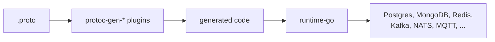

# runtime-go

[](https://github.com/the-protobuf-project/runtime-go/actions/workflows/ci.yml)
[](LICENSE)

**The Go runtime underneath code generated from your `.proto` files.**

The protobuf project's plugins turn a proto service into storage, messaging, APIs
and agent tools. What they generate is thin: names, types and specs. The work
happens here, in small interfaces with a driver for each backend, so a program
written against one database or broker moves to another by changing one line.
Every module is usable by hand as well.



## Start here

| I want to | Module | Generated against it by |
| --- | --- | --- |
| Store proto records in Postgres, MySQL, MongoDB, ArangoDB, Redis, TimescaleDB or an EVM chain | [`database`](database), [`blockchain`](blockchain) | protoc-gen-store |
| Cache them in Redis, Dragonfly, Valkey or memcached | [`cache`](cache) | protoc-gen-cache |
| Publish and consume messages over Kafka, NATS, RabbitMQ, Redis, MQTT, ZeroMQ or OPC UA | [`streams`](streams) | protoc-gen-streams |
| Send changes to webhooks, or drain an outbox to a broker | [`events`](events) | |
| Serve one service over gRPC, REST, MCP and A2A on one port | [`grpc`](grpc) | |
| Let AI agents call a service over MCP or A2A | [`agents`](agents) | protoc-gen-mcp |
| Call HTTP, GraphQL and WebSocket APIs | [`network`](network) | |
| Convert proto messages to FlatBuffers or Cap'n Proto | [`buffers`](buffers) | protoc-gen-buffers |
| Read and write vCard, iCalendar and CalDAV | [`rfc`](rfc) | |
| Trace, measure and log all of the above | [`telemetry`](telemetry), [`observability`](observability) | |

Each module's README walks through it with examples, and every package's Go doc
says how it works.

## Install

Requires Go 1.26. Each module is fetched on its own, so a service that stores
records never downloads a Kafka client:

```sh
go get github.com/the-protobuf-project/runtime-go/database
go get github.com/the-protobuf-project/runtime-go/streams
```

A taste of the streams contract, over Redis:

```go
st, _ := redis.Connect(ctx, "localhost:6379")

s, _ := st.Create(ctx, streams.Stream{Name: "orders", Subjects: []string{"order.placed"}})
mgr, _ := st.Bind(ctx, s.ID)

msgs, _ := mgr.Subscribe(ctx, "order.placed")
mgr.Publish(ctx, "order.placed", order)
```

Swap `redis.Connect` for `nats.ConnectJetStream`, `kafka.Connect` or any other
provider and the rest of the program stays as it is.

<!-- BEGIN PACKAGES (generated by tools/docgen; run `make docs` to refresh) -->
## Modules

Each module is its own `go get`: import the ones you use, and nothing else
comes with them. The summaries are the packages' own docs, collected by
`tools/docgen` (`make docs`).

| Module | What it is for |
| --- | --- |
| [`agents`](agents) | Serves the protocols a model-driven client speaks to a service. |
| [`blockchain`](blockchain) | Stores records on an EVM chain, through the Solidity storage contracts protorm generates. |
| [`buffers`](buffers) | The Go runtime for the converters protoc-gen-buffers generates. |
| [`cache`](cache) | The contract for runtime-go's cache layer. |
| [`database`](database) | Stores Go structs in whichever backend you point it at. |
| [`events`](events) | Sends a service's changes to webhooks. |
| [`events/stream`](events/stream) | Publishes events to a broker through runtime-go's streams contract. |
| [`grpc`](grpc) | Serves one service over gRPC, a REST gateway, MCP and A2A from a single server. |
| [`interfaces`](interfaces) | The generic gRPC layer between a protorm-generated service and a store.Driver. |
| [`network`](network) | Provides GraphQL, HTTP and WebSocket clients behind one factory. |
| [`observability`](observability) | Wires runtime-go modules to the telemetry-go SDK. |
| [`rfc`](rfc) | Converts between the wire formats the IETF specified for contacts and calendars and the protobuf schemas that model them. |
| [`streams`](streams) | Defines the backend-agnostic contract for runtime-go's messaging layer. |
| [`telemetry`](telemetry) | Defines the backend-agnostic contracts generated and hand-written code instruments against. |
| [`ulid`](ulid) | Generates sortable, collision-resistant identifiers for runtime-go modules. |

## Package index

<details>
<summary><b>agents</b> · 4 packages</summary>

`go get github.com/the-protobuf-project/runtime-go/agents`

| Package | What it does |
| --- | --- |
| [`agents`](agents) | Serves the protocols a model-driven client speaks to a service: build one Runtime, register the protocols it should answer, start it. |
| [`agents/a2a`](agents/a2a) | Serves an agent over the Agent2Agent protocol: the agent card that describes it, the transports it answers on, and the execution loop that turns a request into a stream of events. |
| [`agents/mcp`](agents/mcp) | Provides the Go runtime for the code protoc-gen-mcp generates: server configuration, transport handling, and MCP integration helpers. |
| [`agents/shared`](agents/shared) | Holds what every protocol runtime in this module would otherwise copy. |

</details>

<details>
<summary><b>blockchain</b> · 2 packages</summary>

`go get github.com/the-protobuf-project/runtime-go/blockchain`

| Package | What it does |
| --- | --- |
| [`blockchain/evm`](blockchain/evm) | Stores records on an EVM chain, through the Solidity storage contracts protorm generates. |
| [`blockchain/fabric`](blockchain/fabric) | A placeholder store.Driver for Hyperledger Fabric chaincode. |

</details>

<details>
<summary><b>buffers</b> · 1 package</summary>

`go get github.com/the-protobuf-project/runtime-go/buffers`

| Package | What it does |
| --- | --- |
| [`buffers`](buffers) | The Go runtime for the converters protoc-gen-buffers generates: the half of a proto-to-FlatBuffers-or-Cap'n-Proto conversion that does not depend on which message is being converted. |

</details>

<details>
<summary><b>cache</b> · 7 packages</summary>

`go get github.com/the-protobuf-project/runtime-go/cache`

| Package | What it does |
| --- | --- |
| [`cache`](cache) | The contract for runtime-go's cache layer: the interfaces, and nothing that implements them. |
| [`cache/core`](cache/core) | Implements every cache strategy once, over a Driver. |
| [`cache/dragonfly`](cache/dragonfly) | The Dragonfly preset. |
| [`cache/memcached`](cache/memcached) | The memcached backend, and the argument for the driver split. |
| [`cache/redis`](cache/redis) | The Redis preset. |
| [`cache/resp`](cache/resp) | The driver for anything speaking the Redis serialization protocol: Redis itself, Dragonfly, Valkey, KeyDB. |
| [`cache/shared`](cache/shared) | Holds the telemetry this module's code logs and measures through. |

Examples and tools:

- [`cache/example`](cache/example): Runs the cache's three steps — build a client, declare the cache, select a database — against every backend this module supports, and exercises all four strategies over each.

</details>

<details>
<summary><b>database</b> · 9 packages</summary>

`go get github.com/the-protobuf-project/runtime-go/database`

| Package | What it does |
| --- | --- |
| [`database`](database) | Stores Go structs in whichever backend you point it at. |
| [`database/arangodb`](database/arangodb) | Implements the backend-agnostic store.Driver over ArangoDB, and the graph capability alongside it. |
| [`database/cached`](database/cached) | Puts a read-through cache in front of any store.Driver, so a record read repeatedly is fetched from the backing store once. |
| [`database/core`](database/core) | The code every store driver would otherwise copy. |
| [`database/mongodb`](database/mongodb) | Implements the backend-agnostic store.Driver over MongoDB. |
| [`database/orm`](database/orm) | Implements the backend-agnostic store.Driver over GORM. |
| [`database/redis`](database/redis) | Implements the backend-agnostic store.Driver over Redis: durable records addressed by a store.Resource's primary key, stored as proto wire format, with a set of keys alongside so they can be listed. |
| [`database/store`](database/store) | The backend-agnostic core of the runtime data layer: a single CRUD Driver contract that operates on proto messages, a Resource descriptor that mirrors protorm's IR at runtime, and a reflection bridge every driver reuses to move values between a proto message and a backend column map. |
| [`database/timescale`](database/timescale) | Implements the time-series half of the database contract over TimescaleDB. |

Examples and tools:

- [`database/examples/simple/mongodb`](database/examples/simple/mongodb): Stores Go structs in MongoDB.
- [`database/examples/simple/sql`](database/examples/simple/sql): Stores the same struct in a relational database.
- [`database/examples/simple/timescale`](database/examples/simple/timescale): Stores Go structs as time-series data.
- [`database/examples/store/cached`](database/examples/store/cached): Puts a read-through cache in front of a store.
- [`database/examples/store/document`](database/examples/store/document): Stores records in MongoDB and watches them change.
- [`database/examples/store/graph`](database/examples/store/graph): Stores records and the connections between them.
- [`database/examples/store/keyvalue`](database/examples/store/keyvalue): Stores records in Redis.
- [`database/examples/store/sql`](database/examples/store/sql): Stores records in a relational database.
- [`database/examples/store/timeseries`](database/examples/store/timeseries): Partitions a resource by time and reduces over it.

</details>

<details>
<summary><b>events</b> · 1 package</summary>

`go get github.com/the-protobuf-project/runtime-go/events`

| Package | What it does |
| --- | --- |
| [`events`](events) | Sends a service's changes to webhooks: a change-feed dispatcher that reads changes from the records themselves, records one delivery per webhook and change, and POSTs each as a signed CloudEvent until its endpoint accepts it or attempts run out. |

</details>

<details>
<summary><b>events/stream</b> · 1 package</summary>

`go get github.com/the-protobuf-project/runtime-go/events/stream`

| Package | What it does |
| --- | --- |
| [`events/stream`](events/stream) | Publishes events to a broker through runtime-go's streams contract: Kafka, NATS, RabbitMQ, Redis, MQTT, ZeroMQ, whichever provider the stream was created on. |

</details>

<details>
<summary><b>grpc</b> · 6 packages</summary>

`go get github.com/the-protobuf-project/runtime-go/grpc`

| Package | What it does |
| --- | --- |
| [`grpc`](grpc) | Serves one service over gRPC, a REST gateway, MCP and A2A from a single server. |
| [`grpc/hints`](grpc/hints) | Turns an API's generic errors into ones a developer can act on, after the handler has run. |
| [`grpc/idempotency`](grpc/idempotency) | Makes an API's request_id field mean what AIP-155 promises: reusing an id returns what the first call returned, instead of attempting the write a second time. |
| [`grpc/options`](grpc/options) | Holds the configuration for the grpc HybridServer: service identity (name, description, version), the gRPC/HTTP/MCP endpoints, the environment mode, the health/HTTP-3 toggles, and the OpenTelemetry metric selection. |
| [`grpc/problem`](grpc/problem) | Turns a service's typed errors into google.rpc.Status errors a developer can act on (AIP-193): a status code, a message that says what is wrong and what to do, an ErrorInfo with a stable reason, and the detail the error calls for -- BadRequest for a field, PreconditionFailure for a blocked call, ResourceInfo for a missing resource. |
| [`grpc/shared`](grpc/shared) | Holds the process-wide singletons the grpc server initializes once and tears down on exit — currently the Pulse observability client ([Pulse]), constructed in an init with the service identity, log level, and tracing enabled. |

</details>

<details>
<summary><b>interfaces</b> · 1 package</summary>

`go get github.com/the-protobuf-project/runtime-go/interfaces`

| Package | What it does |
| --- | --- |
| [`interfaces/adapter`](interfaces/adapter) | The generic gRPC layer between a protorm-generated service and a store.Driver. |

</details>

<details>
<summary><b>network</b> · 3 packages</summary>

`go get github.com/the-protobuf-project/runtime-go/network`

| Package | What it does |
| --- | --- |
| [`network`](network) | Provides GraphQL, HTTP and WebSocket clients behind one factory. |
| [`network/graphql`](network/graphql) | Provides small helpers and scalar types for generated GraphQL clients: pointer constructors for optional (nullable) arguments, and scalar types that tolerate engine-specific JSON encodings. |
| [`network/runtime`](network/runtime) | The stable, single-import facade that generated GraphQL clients depend on. |

Examples and tools:

- [`network/examples/graphql`](network/examples/graphql): A runnable example of using the network package's GraphQL client to issue queries, mutations, and subscriptions against an endpoint.
- [`network/examples/http`](network/examples/http): A runnable example of using the network package's HTTP client to perform GET, POST, and other requests with retries and context support.
- [`network/examples/websocket`](network/examples/websocket): A runnable example of using the network package's WebSocket client for full-duplex Send/Receive with auto-reconnect and keepalive.
- [`network/examples/graphql/server`](network/examples/graphql/server): A minimal GraphQL server used by the GraphQL client example; it serves a generated schema so the example queries, mutations, and subscriptions have a live endpoint to run against.

</details>

<details>
<summary><b>observability</b> · 1 package</summary>

`go get github.com/the-protobuf-project/runtime-go/observability`

| Package | What it does |
| --- | --- |
| [`observability`](observability) | Wires runtime-go modules to the telemetry-go SDK. |

</details>

<details>
<summary><b>rfc</b> · 3 packages</summary>

`go get github.com/the-protobuf-project/runtime-go/rfc`

| Package | What it does |
| --- | --- |
| [`rfc`](rfc) | Converts between the wire formats the IETF specified for contacts and calendars and the protobuf schemas that model them. |
| [`rfc/caldav`](rfc/caldav) | Serves calendars over CalDAV, RFC 4791, from any store that speaks the RFC protobuf types: RFC 5545 calendars and events and RFC 7953 availability. |
| [`rfc/caldav/memstore`](rfc/caldav/memstore) | An in-memory caldav.Store: the reference implementation of the store contract, for tests, examples and a CalDAV server that needs nothing durable. |

</details>

<details>
<summary><b>streams</b> · 13 packages</summary>

`go get github.com/the-protobuf-project/runtime-go/streams`

| Package | What it does |
| --- | --- |
| [`streams`](streams) | Defines the backend-agnostic contract for runtime-go's messaging layer. |
| [`streams/codec/protobuf`](streams/codec/protobuf) | Encodes stream payloads as protocol buffers. |
| [`streams/core`](streams/core) | The code every streams provider would otherwise copy. |
| [`streams/kafka`](streams/kafka) | Delivers streams over Apache Kafka. |
| [`streams/mqtt`](streams/mqtt) | Delivers streams over MQTT 5. |
| [`streams/nats`](streams/nats) | Delivers streams over NATS, in two forms. |
| [`streams/opcua`](streams/opcua) | Delivers streams over OPC UA. |
| [`streams/opcua/pubsub`](streams/opcua/pubsub) | Delivers streams over OPC UA PubSub (Part 14) on an MQTT broker, in the JSON message mapping. |
| [`streams/rabbitmq`](streams/rabbitmq) | Delivers streams over RabbitMQ. |
| [`streams/redis`](streams/redis) | Implements streams.Streams over Redis. |
| [`streams/shared`](streams/shared) | Holds the telemetry this module's code logs and measures through. |
| [`streams/topic`](streams/topic) | Typed topics: one subject of a stream, its message type, and the defaults it publishes and receives with. |
| [`streams/zeromq`](streams/zeromq) | Delivers streams over ZeroMQ PUB/SUB. |

Examples and tools:

- [`streams/benches/throughput`](streams/benches/throughput): The throughput and latency benchmark for every stream provider.
- [`streams/examples/kafka`](streams/examples/kafka): Demonstrates the streams contract over Apache Kafka.
- [`streams/examples/mqtt`](streams/examples/mqtt): Demonstrates the streams contract over MQTT 5.
- [`streams/examples/nats`](streams/examples/nats): Demonstrates the streams contract over NATS, in both forms, against a live server.
- [`streams/examples/opcua`](streams/examples/opcua): Demonstrates the streams contract over OPC UA.
- [`streams/examples/rabbitmq`](streams/examples/rabbitmq): Demonstrates the streams contract over RabbitMQ.
- [`streams/examples/redis`](streams/examples/redis): Demonstrates the streams contract in all three of the Redis provider's delivery modes, against a live Redis.
- [`streams/examples/zeromq`](streams/examples/zeromq): Demonstrates the streams contract over ZeroMQ PUB/SUB.

</details>

<details>
<summary><b>telemetry</b> · 2 packages</summary>

`go get github.com/the-protobuf-project/runtime-go/telemetry`

| Package | What it does |
| --- | --- |
| [`telemetry`](telemetry) | Defines the backend-agnostic contracts generated and hand-written code instruments against: Meter for metrics, Logger for logs and Tracer for spans. |
| [`telemetry/telemetrytest`](telemetry/telemetrytest) | Records what code reports through the telemetry contracts, for its tests to check: one Recorder is a telemetry.Meter, a telemetry.Tracer and a telemetry.Logger, and keeps every measurement, span and log record in memory. |

</details>

<details>
<summary><b>ulid</b> · 1 package</summary>

`go get github.com/the-protobuf-project/runtime-go/ulid`

| Package | What it does |
| --- | --- |
| [`ulid`](ulid) | Generates sortable, collision-resistant identifiers for runtime-go modules. |

</details>
<!-- END PACKAGES -->

## Telemetry

Every module reports through one contract, [`telemetry`](telemetry): a `Meter`,
a `Logger` and a `Tracer`, together `telemetry.Signals`. Only the
[telemetry SDK](https://github.com/the-protobuf-project/telemetry) imports
OpenTelemetry. [`observability`](observability) adapts it, so an application
builds its SDK once and hands the same signals to every module:

```go
sdk, _ := telemetry.New().WithService("shop", "1.0.0").WithTracing().Build()
observability.Adopt(sdk)
obs := observability.Lazy("shop", "1.0.0")()
signals := rtelemetry.Signals{Meter: obs.Meter(), Tracer: obs.Tracer(), Logger: obs.Log()}
```

| Module | Turn it on |
| --- | --- |
| streams | `streams.Instrument(provider, signals, "nats")`, and `topic.NewTelemetry` for typed topics |
| database | `store.Instrument(db, store.WithSignals(signals))` |
| cache | `cache.WithObservability(doc, signals)` |
| events | `events.Options{Meter, Tracer, Logger}` |
| network | `network.ConnectionOptions{Signals: signals}` |
| agents | `agents.Config{Signals: signals}` |
| grpc | on by default, for every call |

Each unit of work is a span named `<component>.<operation>` and a share of the
same metrics in every module, `runtime.operation.count`, `.duration` and
`.active`, `runtime.records.read` and `.written`, labeled component, backend,
operation and outcome, as runtime-rs reports them. Traces cross every process
boundary in W3C `traceparent` headers: a stream message, an HTTP or GraphQL
request, a gRPC call, a webhook delivery.

## Development

```sh
make docs         # regenerate the Modules and Package index sections above
make docs-check   # what CI runs: every package has a doc.go, this README is current
```

The Modules table and the Package index are generated from each package's
`doc.go` by [`tools/docgen`](tools/docgen); edit the doc, not this file.

## Contributing

Issues and pull requests are welcome. Please open an issue before submitting a large change so we can discuss the approach first.

## License

Apache 2.0, see [LICENSE](LICENSE).

© 2026 the-protobuf-project
