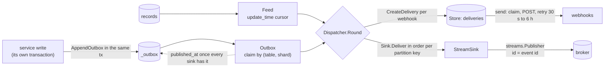

# Outbox source and stream sink

Status: implemented (stage B). The open questions below are answered at the end.

`events` today has one source and one sink. It reads changes from records ordered
by `update_time` (a [Feed](../../feed.go)) and sends them to webhooks, as
[Delivery](../../store.go) records the dispatcher retries. This proposal adds a
second source and a second sink:

- **Outbox source.** It drains the `<table>_outbox` rows protoc-gen-store generates,
  in insertion order, safely across servers.
- **Stream sink.** It publishes changes to a runtime-go `streams` Publisher, on any
  backend.

One identity runs from end to end. An outbox row's ULID is the CloudEvent id, the
streams message id and the `webhook-id` header, so every consumer dedups on one
key across retries, fan-out and redelivery.

## Contents

- [Summary of decisions](#summary-of-decisions)
- [Where the outbox fits](#where-the-outbox-fits)
- [Stream delivery: broker acks, not Delivery records](#stream-delivery-broker-acks-not-delivery-records)
- [Failure analysis](#failure-analysis)
- [Ordering](#ordering)
- [Store interface](#store-interface)
- [Public API](#public-api)
- [Metrics](#metrics)
- [Test plan](#test-plan)
- [Contract other runtimes must match](#contract-other-runtimes-must-match)
- [Open questions](#open-questions)

## Summary of decisions

| Question | Decision |
| --- | --- |
| Is the outbox a kind of Feed? | No. It is an `Outbox` the dispatcher drains beside its feeds. Outbox rows are append-only and carry their own "done" marker, so none of the feed's cursor, Lag, seen-set or etag-refetch machinery applies. |
| Stream delivery through Delivery records? | No. Stream delivery relies on broker acks plus `published_at`. Webhooks from an outbox still go through Delivery records, unchanged. |
| Claiming across servers | One drainer per (table, shard) at a time, chosen by `pg_try_advisory_xact_lock`. Rows are read in `(created_at, id)` order with `FOR UPDATE`. |
| `published_at` means | The row's event was handed durably to every sink: delivery records written for every webhook that wants it, and the broker acknowledged it on the stream. |
| Per-aggregate order | Guaranteed in publish order. Partition key = `aggregate_id`. Only one drainer per aggregate's shard at a time, with in-order lanes. |
| Store interface | Unchanged. The outbox claim lives on a separate `OutboxClaimer`, so protoc-gen-service's generated `EventStore` compiles as it is. |
| Poison events | Stall loudly by default (nothing is lost). A dead-letter subject is opt-in. |
| Writer helper | `AppendOutbox(ctx, tx, table, entry)` over any `ExecContext`: `*sql.Tx`, or gorm's `tx.Statement.ConnPool`. |



## Where the outbox fits

### Not a Feed

A `Feed` exists for records that change in place. Its round logic deals with
problems an outbox does not have:

| Feed machinery | Why the feed needs it | Outbox |
| --- | --- | --- |
| `Cursor` by `update_time`, etag-guarded | records have no "sent" marker; position is time | each row has `published_at`; outstanding = `published_at IS NULL` |
| `Lag` reread | a write may commit after a later one was read | a late commit is still `published_at IS NULL`; the next claim finds it |
| seen-set, `settle` | rereads within `Lag` would record twice | no rereads |
| etag refetch (`recordAll`) | the version read may be gone by the time it is sent | an outbox row is immutable; its payload is the version |
| `HookSettle` | a webhook created mid-round might miss changes | still applies: see below |

Running an outbox through the feed path would reread up to `Lag` of rows every
round and never use `published_at`. Pretending the table is a record of
`update_time` would also lose the property that matters most: a row is
outstanding until marked, whatever the clocks say.

### A separate source the Dispatcher accepts

`Options` gains `Outboxes []*Outbox` and `Sink Sink`. Both are additive, and
`NewDispatcher(store, feeds, opts)` keeps its signature. `Round` becomes:

```
Round:
  dispatch   feeds, as today; changes also go to Sink when one is set
  drain      new: each Outbox, each shard it can lock
  send       as today: due webhook deliveries
  prune      as today, plus published outbox rows past OutboxSpec.Retention
```

What changes in `Dispatcher`:

1. **`dispatch`.** It reads the webhooks once a round, as today. The same list
   and the same `upTo` (now less `HookSettle`) are passed to `drain`. An outbox row
   is drained in a round only if `created_at <= upTo`, so a webhook created as the
   round starts is never skipped. This is the same rule feeds follow. `upTo` is
   the dispatcher's clock and `created_at` the database's, so this assumes their
   skew is under `HookSettle`, as feeds already assume of `update_time`.
2. **`dispatchFeed`.** A change is fetched and recorded when some webhook wants it
   *or* a `Sink` is set (`wantedBy(hooks, c) || d.sink != nil`).
   - `record` hands the rendered event to `Sink.Deliver` after writing the
     deliveries. A sink failure returns from the round before `UpdateCursor`, so
     the cursor does not pass an unpublished change. `remember` runs only after
     both succeed.
   - Feed events keep their id, `EventID(name, etag)`. A feed has no outbox row,
     so there is no ULID to carry.
3. **`drain` (new).** For each outbox and each shard:
   1. Claim the shard (one transaction, advisory lock, `FOR UPDATE`).
   2. Render each row once as a CloudEvent.
   3. `CreateDelivery` for every webhook that `Wants` it (`ErrAlreadyExists` is
      ignored, as today).
   4. `Sink.Deliver` the batch.
   5. Mark `published_at` for every row both sinks accepted, then commit.
   - A row the sink did not accept stays outstanding, and so does everything after
     it with the same partition key.
4. **`send`, `attempt` and `post`.** Unchanged. A webhook delivery from an outbox
   is a `Delivery` like any other: its `EventID` is the ULID, so `webhook-id` and
   the delivery's name derive from it.
5. **`prune`.** Also deletes published outbox rows older than
   `OutboxSpec.Retention`, at most `prunePage` rows per table per round.

A resource is served by a Feed or by an Outbox, never both. Both would send two
events for one write, under two ids. This is documented, and `NewDispatcher`
cannot detect it, because a feed does not know its table.

## Stream delivery: broker acks, not Delivery records

**Recommendation: the stream sink does not write Delivery records.** The broker's
acknowledgement inside the claim transaction is the record. `published_at` is
written only after it.

Reasons, against routing stream delivery through `Delivery`:

1. **The Store shape forbids it without a breaking change.** In protoc-gen-service's
   generated `EventStore`, a delivery is a child resource of a webhook:
   - `Deliveries.Create(ctx, webhook, m)` creates it under the webhook.
   - `DueDeliveries` lists `"webhooks/-"`.
   - `send` calls `GetWebhook`, and a missing one fails the delivery with "the
     webhook was deleted".

   A stream sink would need a fake webhook row (and an endpoint, a secret, a
   scope), or a new parent collection the generated code does not have.
2. **It reorders.** Deliveries are retried one at a time on their own schedule.
   Event n+1 of an aggregate would go out while event n waits out its 30-second
   backoff. The broker path keeps a partition in order by not starting n+1 until n
   is acknowledged.
3. **It doubles the write load on the hot path.** That's one extra row per event
   per sink, on the path whose whole point is throughput. Brokers already persist,
   replicate and acknowledge; a second durable record per message buys nothing the
   outbox row does not already give.
4. **Observability does not need it.** `<prefix>.attempts` and
   `<prefix>.delivery_lag` come from the sink. The row's `published_at` minus
   `created_at` is the end-to-end lag, queryable in SQL.

Webhooks keep Delivery records. Endpoints fail individually, for hours, and must
not hold the table up. Recording the delivery is the durable hand-off for a
webhook, and its own retries take over from there.

## Failure analysis

| Failure | What happens | Result |
| --- | --- | --- |
| Crash after the broker acked, before `published_at` committed | The claim transaction dies with the connection, so the row stays outstanding and its lock is released. The next claim republishes it under the same id, and `CreateDelivery` collides on `DeliveryName(webhook, id)`. | No webhook is POSTed twice. The stream sees a duplicate with the same message id: JetStream drops it within its duplicate window; elsewhere consumers dedup on the id. At-least-once, one key. |
| Crash after some deliveries were written, before the stream publish | Rollback leaves the row outstanding. Deliveries written by the Store (often another transaction or database) stay, and are sent by `send` as usual. | On retry, deliveries collide (ignored) and the stream gets the event. Webhooks may see it before the stream does; nothing is lost or doubled. |
| Broker down | `Deliver` fails with a transient error. Rows it did not accept stay outstanding; rows it accepted earlier in the batch are marked. The shard backs off 1 s, doubling to 60 s, never giving up. | A stream outage stalls that shard's later events, which ordering requires. Webhook deliveries already recorded keep being sent. `outbox.attempts{outcome=retrying}` climbs. |
| Database down | Claim fails. The round returns the error, as `dispatch` does today. | Nothing is claimed, nothing is lost. |
| Poison event (the broker refuses it for good: oversized, a header it rejects, an undeclared subject) | The sink wraps the failure in `ErrUndeliverable`. Without a dead-letter subject, the row and its partition's later rows stay outstanding, `outbox.attempts{outcome=failed}` counts it, and the round reports the row id and reason. With `StreamSinkOptions.DeadLetter`, the event goes to that subject with headers `outbox-error` (the reason) and `ce-type` (the original type), and counts as accepted. | The default is a loud stall: no silent loss, and an operator fixes or dead-letters it. A `payload` that is not JSON cannot occur (the column is JSONB, NOT NULL). |
| Rolled-back writer | The row was written in the writer's transaction, so it never commits and is never visible to the claim (READ COMMITTED). | No event. |
| Webhook and stream sink both configured for one change | The row is rendered once into one CloudEvent body. That body is the webhook's POST body (signed, `webhook-id` = ULID) and the stream message payload (message id = ULID). | Same bytes, same id. A consumer of both dedups on one key. |
| Two servers drain the same table | The advisory lock admits one per (table, shard). The other skips that shard this round. | No double publish from contention; throughput scales with shards. |
| A drainer stalls holding the lock | The lock is transaction-scoped. `OutboxSpec.ClaimTimeout` (default 30 s) bounds the claim: `SET LOCAL statement_timeout` for each statement, `SET LOCAL idle_in_transaction_session_timeout` for the time spent publishing between them (Postgres ends the session, releasing the lock), and the same deadline on the publish context. | The lock frees at most `ClaimTimeout` later; the rows are republished. |

## Ordering

| Scope | Guarantee |
| --- | --- |
| One aggregate | Events are published, and recorded for webhooks, in `(created_at, id)` order. Event n+1 is not sent until the broker has acknowledged n. Partition key = `aggregate_id`. |
| One aggregate, on the consumer side | As the broker orders one partition key: Kafka within a partition of one topic, NATS JetStream and MQTT within a subject, RabbitMQ within a queue. Because subject = event type, two event types of one aggregate travel on two subjects (two Kafka topics), and a consumer reading both has no cross-subject order. `StreamSinkOptions.Subject` can map every event of a resource to one subject (e.g. `shop.order.events`, type in the `ce-type` header) where strict per-aggregate order at the consumer matters. |
| Across aggregates | None promised. Within a round they come out in `(created_at, id)` order. A writer transaction that commits after a later one was drained is published in a later round. |
| Webhooks | As today: every delivery is retried on its own schedule, so no order is promised. |

Why `(created_at, id)` order is the aggregate's commit order:
- `AppendOutbox` inserts `created_at = clock_timestamp()` at insert time, not the
  column default `now()` (which is the transaction's start).
- The contract asks writers to insert the outbox row after writing the aggregate's
  own row, in the same transaction. Writers of one aggregate are serialised by
  that row's lock, so their insert times follow their commit order.
- The id (a ULID minted at insert) breaks ties.

Shards keep this true across servers:
- A row's shard is a stable hash of `aggregate_id` (see the contract), so one
  aggregate is always in one shard.
- One server at a time holds a shard.
- Inside the sink, events go out on in-order lanes keyed by partition key
  (default 16), so different aggregates publish concurrently while each aggregate
  stays sequential.

`streams.Batch` cannot be used here: it refuses `streams.ID`, and every event
needs its own pinned id. The lanes are what give throughput instead.

## Store interface

**No change to `Store`.** The outbox does not touch webhooks, deliveries or
cursors beyond what `Store` already offers. Its claim and mark operations live on
a separate interface the `Outbox` is built from:

```go
// OutboxClaimer claims outstanding rows of one outbox table. PostgresOutbox is
// the implementation for the tables protoc-gen-store generates; a fake one
// tests the dispatcher.
type OutboxClaimer interface {
	// Claim locks shard (of shards) and up to limit of its outstanding rows
	// created at or before upTo, oldest first. ok is false when another server
	// holds the shard; nothing is locked then.
	Claim(ctx context.Context, shard, shards, limit int, upTo time.Time) (claim OutboxClaim, ok bool, err error)
	// Prune deletes up to limit rows published before before.
	Prune(ctx context.Context, before time.Time, limit int) error
}

// OutboxClaim is one claimed batch, open until Commit or Release.
type OutboxClaim interface {
	Rows() []OutboxRow
	// Commit marks published the rows named and ends the claim.
	Commit(ctx context.Context, published []string) error
	// Release ends the claim without marking anything.
	Release() error
}
```

protoc-gen-service's generated `EventStore` implements `Store` and nothing else.
It compiles unchanged, because nothing it implements or constructs changes:
- `Delivery`, `Webhook` and `Cursor` keep every field (none is added).
- `DeliveryState` keeps its three values.
- Every new type, field and function is additive.

In stage B, this is proved by building its golden output (`webhook`, `booking`,
`calendar`, `directory`, `idempotency`, `purge`) against the branch through a
`replace`.

## Public API

Additions to package `events`:

```go
// Event is one change ready for a sink: the rendered CloudEvent and what a
// broker needs to route it.
type Event struct {
	ID           string    // CloudEvent id: outbox row id, or EventID(name, etag) from a feed
	Type         string    // CloudEvent type
	Subject      string    // CloudEvent subject: the resource name
	Time         time.Time // CloudEvent time
	Scope        string    // matched against Webhook.Scope
	PartitionKey string    // aggregate id, or the record name from a feed
	Body         []byte    // the CloudEvent, structured-mode JSON, exactly as POSTed to webhooks
}

// Sink is where the dispatcher sends events besides webhooks.
type Sink interface {
	// Deliver sends batch, in order per partition key, and reports which
	// entries the sink accepted: sent[i] for batch[i]. An entry after a failed
	// one of the same partition key is not attempted. err joins the failures;
	// one the sink can never deliver wraps ErrUndeliverable.
	Deliver(ctx context.Context, batch []Event) (sent []bool, err error)
}

// ErrUndeliverable marks a failure no retry can fix (see Sink).
var ErrUndeliverable = errors.New("events: undeliverable")

// Options gains:
//	Outboxes []*Outbox // drained each round, after the feeds
//	Sink     Sink      // receives every feed change and outbox event; nil sends to webhooks only

// OutboxRow is one row of a <table>_outbox.
type OutboxRow struct {
	ID          string    // ULID
	AggregateID string    // the owner's primary key, as text
	EventType   string
	Payload     []byte    // JSON
	CreateTime  time.Time
}

// OutboxSpec describes how one outbox table is drained.
type OutboxSpec struct {
	// Name labels the outbox's metrics and errors, e.g. "shop.orders".
	Name string
	// Subject is an event's CloudEvent subject. Default: the payload's
	// top-level "name" string (an AIP resource name), else the aggregate id.
	Subject func(r OutboxRow) string
	// Scope is an event's scope for webhooks (Webhook.Scope). Default "".
	Scope func(r OutboxRow, subject string) string
	// Shards splits the table by aggregate so several servers drain it at
	// once. Default 1. Changing it is safe at any time; see the contract.
	Shards int
	// BatchSize bounds one claim. Default 500.
	BatchSize int
	// ClaimTimeout bounds one claim's transaction and publish. Default 30 s.
	ClaimTimeout time.Duration
	// Retention is how long published rows are kept. Default 7 days; negative
	// keeps them.
	Retention time.Duration
	// MetricPrefix names the metrics. Default "outbox".
	MetricPrefix string
}

// NewOutbox drains c as spec describes.
func NewOutbox(c OutboxClaimer, spec OutboxSpec) *Outbox

// PostgresOutbox is the OutboxClaimer for a table protoc-gen-store generated,
// e.g. "shop.orders_outbox", over database/sql (any Postgres driver).
func PostgresOutbox(db *sql.DB, table string) (OutboxClaimer, error)

// Execer is what AppendOutbox writes through: *sql.Tx, *sql.Conn, *sql.DB, or
// gorm's tx.Statement.ConnPool.
type Execer interface {
	ExecContext(ctx context.Context, query string, args ...any) (sql.Result, error)
}

// OutboxEntry is one event to append. ID is minted (a ULID) when empty.
type OutboxEntry struct {
	ID          string
	AggregateID any // the owner's primary key, typed as its column is
	Type        string
	Payload     []byte // JSON
}

// AppendOutbox inserts e into table inside the caller's transaction and
// returns its id. Call it after writing the aggregate's own row, in the same
// transaction (see Ordering).
func AppendOutbox(ctx context.Context, tx Execer, table string, e OutboxEntry) (string, error)
```

New package `events/stream`, so `events` itself does not import broker code:

```go
// Sink publishes events to a runtime-go streams Publisher: subject = the event
// type (or Options.Subject), message id = the event id, partition key = the
// event's, the CloudEvent as a JSON payload, and the ce-* headers.
func NewSink(p streams.Publisher, opts Options) *Sink

type Options struct {
	// Subject maps an event to its subject. Default: the event type.
	Subject func(e events.Event) string
	// Lanes is how many partition keys publish at once. Default 16.
	Lanes int
	// DeadLetter is a subject undeliverable events are published to instead
	// of stalling. Empty stalls (the default).
	DeadLetter string
	// MetricPrefix names the metrics. Default "stream".
	MetricPrefix string
	Meter        telemetry.Meter
}
```

Usage:

```go
// In the service's write path.
err := db.Transaction(func(tx *gorm.DB) error {
    if err := tx.Create(&order).Error; err != nil {
        return err
    }
    payload, _ := protojson.Marshal(orderpb)
    _, err := events.AppendOutbox(ctx, tx.Statement.ConnPool, "shop.orders_outbox", events.OutboxEntry{
        AggregateID: order.ID, Type: orderv1svc.OrderCreatedEvent, Payload: payload,
    })
    return err
})

// In the dispatcher's process.
orders, _ := events.PostgresOutbox(sqlDB, "shop.orders_outbox")
d := events.NewDispatcher(store, feeds, events.Options{
    Source:   "//shop.example.com",
    Outboxes: []*events.Outbox{events.NewOutbox(orders, events.OutboxSpec{Name: "shop.orders", Shards: 4})},
    Sink:     stream.NewSink(manager, stream.Options{Meter: meter}),
    Meter:    meter,
})
d.Start(ctx, time.Second, logErr)
```

## Metrics

They follow the existing `<prefix>.attempts{outcome}` / `<prefix>.delivery_lag`
shape. The outcome values are the existing constants plus one new one,
`dead_lettered`.

| Metric | Kind | Labels | Meaning |
| --- | --- | --- | --- |
| `webhook.attempts`, `webhook.delivery_lag` | unchanged | unchanged | as today, outbox webhooks included |
| `outbox.attempts` | counter | `outcome` = `succeeded` / `retrying` / `failed`, `outbox` = `OutboxSpec.Name` | rows whose claim committed published (succeeded), rows left outstanding by a transient failure (retrying), rows stalled on `ErrUndeliverable` (failed) |
| `outbox.delivery_lag` | histogram (s), the existing buckets | `outbox` | `published_at - created_at` per published row |
| `outbox.claims` | counter | `outbox`, `result` = `claimed` / `contended` / `empty` | how often a shard was claimed, held by another server, or had nothing outstanding |
| `stream.attempts` | counter | `outcome` = `succeeded` / `retrying` / `failed` / `dead_lettered` | one per event the sink tried |
| `stream.delivery_lag` | histogram (s) | — | broker acknowledgement time minus the event's `Time` |

## Test plan

**Unit tests** (no database or broker, `go test ./...`). Fakes: `memStore` as
today, a `fakeClaimer` with an in-memory table and lock table, and a `fakeSink`
recording calls with scriptable failures per partition key.

- Drain marks only what every sink accepted. A failure for partition key `a`
  leaves `a`'s later rows outstanding and still marks `b`'s.
- Republish after an injected crash: commit fails after `Deliver`, so the next
  round sends the same ids and `CreateDelivery` collides. No second POST.
- `upTo` (HookSettle) holds back rows newer than the webhook read.
- Contended shard: `ok == false` is skipped, and `outbox.claims{result=contended}`
  counts it.
- `ErrUndeliverable` stalls the partition, with no `published_at`;
  `outbox.attempts{outcome=failed}`.
- Shard backoff goes 1 s, 2 s, ... 60 s, then resets after a success.
- Feed changes reach the sink, and the cursor does not move past a failed
  `Deliver`.
- Identity: one row gives the same id in the CloudEvent `id`, the webhook-id
  header, `DeliveryName` and the published message id. The body bytes POSTed and
  published are equal.
- `events/stream`, against an in-memory `streams` Manager:
  - subject, id, partition key and headers are as the contract says
  - lanes keep per-key order under concurrency (`-race`)
  - a dead letter goes to the configured subject with `outbox-error`
- The contract vectors below as table tests:
  - advisory lock key
  - shard of an aggregate id
  - `EventID` and `DeliveryName`
  - CloudEvent bytes for a fixed row

**Postgres integration tests** (`//go:build live`, docker compose:
`events/docker/compose.postgres.yaml`, postgres:17 on 127.0.0.1). They run the
generated `orders_outbox` DDL from protoc-gen-store's golden output.

- `AppendOutbox` inside a committed `*sql.Tx` and a gorm transaction gives one
  row; a rolled-back one gives none.
- Two dispatchers on one table publish every row exactly once into a capturing
  sink, with per-aggregate order preserved under 4 shards and 10,000 rows across
  200 aggregates.
- Claim SQL against the real planner:
  - `EXPLAIN` uses `idx_<table>_unpublished`
  - `statement_timeout` releases a stalled claim
- Prune deletes only published rows past retention.

**Crash-injection tests** (live):
- `pg_terminate_backend` on the claim's connection between `Deliver` and
  `Commit`: the rows are republished with the same ids.
- Kill the sink mid-batch: the accepted prefix of each key is marked, the rest
  republished in order.
- Broker container stopped for 30 s with an end-to-end run against the NATS
  JetStream compose from runtime-go/streams: nothing is lost, duplicates fall
  within the dedup window, and per-aggregate order holds.

**Generated code.** `go build ./...` over protoc-gen-service's golden `goservice`
trees against this branch via `replace`.

## Contract other runtimes must match

runtime-rs ports this byte for byte. Everything below is normative. Items marked
(existing) already hold today and are restated so the port has them in one
place.

### Identity

1. Outbox event id = the row's `id` (26-character ULID, Crockford base32,
   uppercase). It is used unchanged as:
   - the CloudEvent `id`
   - the streams message id (frame field "message id")
   - the `webhook-id` header
   - the input to `DeliveryName`
2. Feed event id (existing): `EventID(name, etag)` = lowercase hex of the first
   16 bytes of SHA-256(`name` || 0x00 || `etag`).
3. Delivery name (existing): `DeliveryName(webhook, eventID)` = `webhook` +
   `"/deliveries/d"` + the first 31 hex characters of the lowercase hex of the
   first 16 bytes of SHA-256(`webhook` || 0x00 || `eventID`).

### CloudEvent

4. Structured-mode JSON, compact (no insignificant whitespace), members in exactly
   this order:

   ```json
   {"specversion":"1.0","id":"…","source":"…","type":"…","subject":"…","time":"…","datacontenttype":"application/json","data":…}
   ```

   - String escaping as Go's `encoding/json` does: `<`, `>` and `&` are written as
     `\u003c`, `\u003e` and `\u0026`; U+2028 and U+2029 as `\u2028` and `\u2029`;
     invalid UTF-8 as `\ufffd`.
   - `time`: UTC, RFC 3339 with fractional seconds only as far as non-zero
     (`2006-01-02T15:04:05.999999999Z`; no fraction when zero).
   - `data`: the payload JSON, compacted as `json.Compact` does, with the same
     escaping as strings.
5. For an outbox row:
   - `source` = `Options.Source`
   - `type` = `event_type`
   - `time` = `created_at`
   - `data` = `payload` as Postgres returns `payload::text`, compacted
   - `subject` = `OutboxSpec.Subject(row)`. The default is the payload's
     top-level `name` member when it is a JSON string, else `aggregate_id` as text.
6. The bytes POSTed to webhooks and the bytes published to the broker are the
   same bytes.

### Webhook delivery (existing)

7. Request headers:
   - `Content-Type: application/cloudevents+json; charset=utf-8`
   - `webhook-id`: the event id
   - `webhook-timestamp`: unix seconds
   - `webhook-signature`: space-separated `v1,<base64 HMAC-SHA256>` values
     (Standard Webhooks) of `<id>.<timestamp>.<body>`, keyed by the base64-decoded
     secret after `whsec_`, current secret first, then the previous one within
     `RotationGrace`.
   - Any 2xx accepts; redirects are not followed.
8. Retry schedule:
   - Attempt n failing waits `min(30 s × 2^(n−1), 6 h)`.
   - The delivery is `FAILED` after `MaxAttempts` (8) attempts or when its webhook
     is gone.
   - A claim pushes `next_attempt_time` 1 minute out.
   - Finished deliveries are pruned after 30 days.

### Broker message

9. Message, written with the streams contract's frame:
   - subject = the event type, unless the sink's `Subject` option maps it
   - message id = the event id
   - codec `json`
   - data = the CloudEvent bytes from rule 4, unchanged
   - partition key = `aggregate_id` as text (outbox) or the record name (feed)
10. Headers, set on every message and lowercase:

    | Key | Value |
    | --- | --- |
    | `ce-specversion` | `1.0` |
    | `ce-id` | event id |
    | `ce-source` | source |
    | `ce-type` | event type |
    | `ce-subject` | subject |
    | `ce-time` | as rule 4 |
    | `ce-partitionkey` | partition key (CloudEvents partitioning extension) |
    | `content-type` | `application/cloudevents+json; charset=utf-8` |

    A dead-lettered message also carries `outbox-error` (the failure, one line,
    at most 1,024 bytes) and keeps every header above.
11. Stream retry: a shard whose sink failed transiently is next claimed after
    1 s × 2^(k−1), at most 60 s, where k counts consecutive failed rounds. There
    is no attempt limit.

### Outbox SQL (PostgreSQL)

12. `<table>` is `"schema"."table"`. Each part must match
    `[A-Za-z_][A-Za-z0-9_]*` and is double-quoted.
13. Insert, in the writer's transaction, after the aggregate's own row:

    ```sql
    INSERT INTO <table> (id, aggregate_id, event_type, payload, created_at)
    VALUES ($1, $2, $3, $4::jsonb, clock_timestamp())
    ```
14. Lock key for (table, shard): the first 8 bytes, big-endian, as a signed
    64-bit integer, of SHA-256(`"the-protobuf-project/events/outbox"` || 0x00 ||
    `<table as given, unquoted, e.g. shop.orders_outbox>` || 0x00 || `<shard in
    decimal>` || 0x00 || `<shards in decimal>`).
15. Shard of a row, when shards > 1:

    ```sql
    (('x' || substr(md5(aggregate_id::text), 1, 8))::bit(32)::int & 2147483647) % <shards>
    ```

    That is the first 4 bytes of MD5(`aggregate_id` as text) as a big-endian
    integer, with the top bit cleared, modulo shards.
16. Claim, in one transaction, READ COMMITTED:

    ```sql
    SET LOCAL statement_timeout = '<ClaimTimeout in ms>ms';
    SET LOCAL idle_in_transaction_session_timeout = '<ClaimTimeout in ms>ms';
    SELECT pg_try_advisory_xact_lock($1);            -- $1 = lock key; false: skip the shard
    SELECT id, aggregate_id::text, event_type, payload::text, created_at
      FROM <table>
     WHERE published_at IS NULL
       AND created_at <= $1                          -- upTo
       [AND <shard expression> = $3]                 -- shards > 1
     ORDER BY created_at, id
     LIMIT $2
       FOR UPDATE;
    ```
17. Mark, in the same transaction, then `COMMIT`:

    ```sql
    UPDATE <table> SET published_at = clock_timestamp()
     WHERE id = ANY(string_to_array($1, ',')::char(26)[])   -- $1 = ids joined by ','
    ```
18. Prune, outside any claim:

    ```sql
    DELETE FROM <table> WHERE id IN (
      SELECT id FROM <table> WHERE published_at < $1 ORDER BY published_at LIMIT $2)
    ```
19. Changing `Shards` is safe. A lock key includes the shard count, so during the
    change two servers may briefly drain one aggregate under different keys. That
    can reorder one aggregate's events across the change, but never lose them;
    roll a shard change out with the dispatchers stopped for strict order.

### Metrics

20. Names and labels are as in [Metrics](#metrics). Each `<prefix>` is
    configurable and defaults to `webhook`, `outbox` and `stream`.

## Open questions

Answered for stage B: the subject stays generic (the event type by default,
any mapping through `stream.Options.Subject`), and `stream.NewSink` checks at
startup that the stream declares a subject for every event type it is given.

1. **Subject per event type.** Rule 9 makes subject = event type, as asked, so
   per-aggregate order at the consumer holds only within one event type (see
   Ordering). Should the default be one subject per resource (for example the
   resource type, `shop.order`) with the type in `ce-type`? That would make
   consumer-side order hold by default.
2. **protoc-gen-streams' stream declaration.** A stream must declare its subjects.
   The sink does not create streams; it publishes through a bound `Manager`, so
   protoc-gen-streams (or the service) must declare every event type. A
   `Manager` that refuses an undeclared subject makes a missing declaration a
   poison event that stalls the outbox. Is that the right failure, or should the
   sink check the declared subjects when it is built?
3. **`streams.Batch` with per-entry ids.** A batch API that takes an id per entry
   would let the sink use Kafka's and JetStream's native batching instead of
   lanes. That is a runtime-go/streams change, out of scope here.
