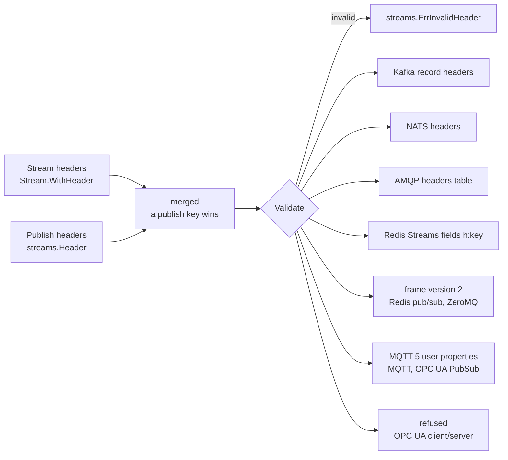
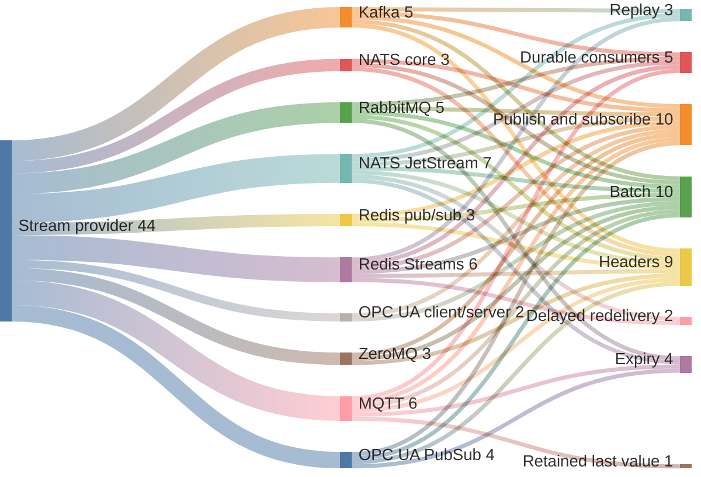
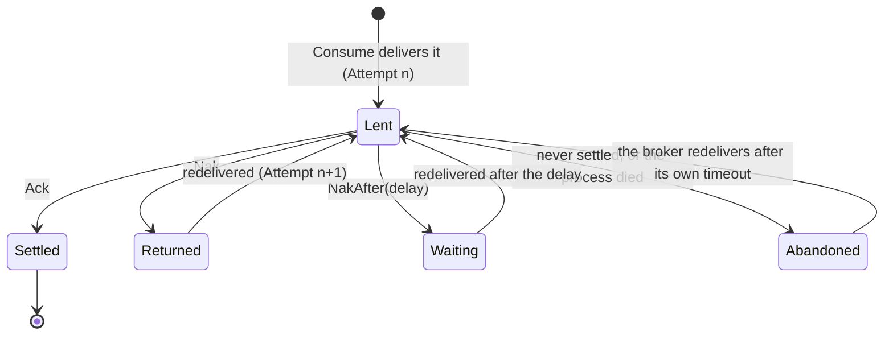
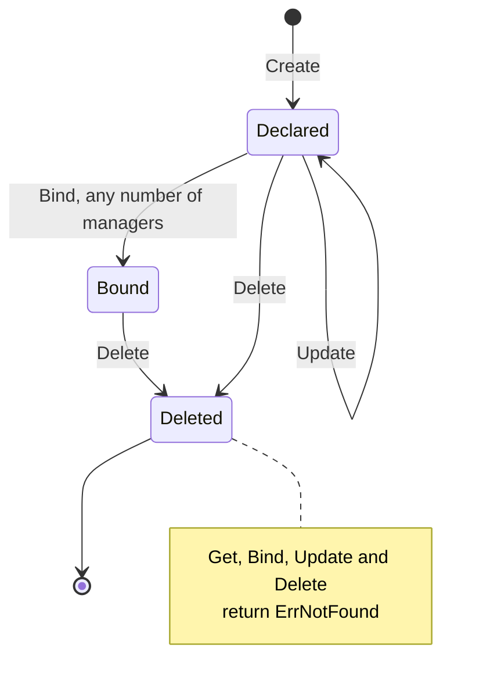
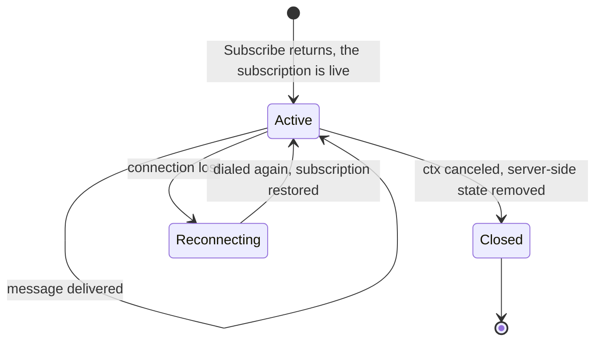

# Streams

Messaging with a backend-agnostic contract. One publish/subscribe interface over
pub/sub, stored logs and scheduled delivery; a provider implements what its
backend can do and says so where it cannot.

| Backend | Package | Delivery |
| --- | --- | --- |
| Redis pub/sub | [`streams/redis`](./redis) | immediate, nothing kept |
| Redis scheduled | [`streams/redis`](./redis) | on TTL expiry |
| Redis Streams | [`streams/redis`](./redis) | durable, redelivered until acknowledged |
| Core NATS | [`streams/nats`](./nats) | immediate, nothing kept |
| NATS JetStream | [`streams/nats`](./nats) | durable, redelivered until acknowledged |
| Kafka | [`streams/kafka`](./kafka) | durable, partitioned, replayable by offset |
| MQTT 5 | [`streams/mqtt`](./mqtt) | durable by session, not replayable |
| RabbitMQ | [`streams/rabbitmq`](./rabbitmq) | durable by queue, true negative acknowledgement |
| ZeroMQ | [`streams/zeromq`](./zeromq) | brokerless, immediate, nothing kept |
| OPC UA | [`streams/opcua`](./opcua) | each change to a node's value |
| OPC UA PubSub | [`streams/opcua/pubsub`](./opcua/pubsub) | Part 14 JSON over MQTT, nothing kept |

For ephemeral, TTL-bound entries see [`cache`](../cache); for durable records see
[`database`](../database).

## Installation

```bash
go get github.com/the-protobuf-project/runtime-go/streams
```

## Usage

`Connect` dials, so nothing but this module is imported and the package name is
the backend's:

```go
import (
    "github.com/the-protobuf-project/runtime-go/streams"
    "github.com/the-protobuf-project/runtime-go/streams/redis"
)

events, err := redis.Connect(ctx, "localhost:6379")   // a streams.Streams
defer events.(streams.Closer).Close()
```

Everything after that line is the interface, so pointing this at another backend
means changing the import and the constructor and nothing else:

```go
import "github.com/the-protobuf-project/runtime-go/streams/nats"

events, err := nats.ConnectJetStream(ctx, "nats://localhost:4222")
```

**`Connect` dials and owns; `Use` takes a client you built.** Every provider has
`Connect`; those whose client is worth sharing with the rest of a program also
have `Use`:

```go
rdb := goredis.NewClient(&goredis.Options{ /* TLS, cluster, pooling */ })
defer rdb.Close()

events := redis.Use(rdb)   // this package will not close what it did not open
```

A provider that dialed implements `streams.Closer`; one built by `Use` also
implements it, as a no-op, so a caller may close either without knowing which it
has.

| | Dials | Takes a client |
| --- | --- | --- |
| Redis | `Connect`, `ConnectScheduled`, `ConnectDurable` | `Use`, `UseScheduled`, `UseDurable` |
| NATS | `Connect`, `ConnectJetStream` | `Use`, `UseJetStream` |
| Kafka | `Connect` | — |
| RabbitMQ | `Connect` | `Use` |
| MQTT | `Connect` | `Use` |
| ZeroMQ | `Publish`, `Subscribe` | — |
| OPC UA | `Connect` | `Use` |
| OPC UA PubSub | `Connect` | — |

MQTT connections reconnect on their own, and take TLS and credentials:

```go
events, err := mqtt.Connect(ctx, "mqtts://broker.example",
    mqtt.WithTLS(&tls.Config{Certificates: []tls.Certificate{clientCert}}), // mTLS, as AWS IoT wants
    mqtt.WithCredentials("plant", password),
)
```

A dropped connection is dialed again; a publish waits for it as long as its
context allows, a subscription is restored on the new connection, and a durable
consumer's session resumes with nothing lost.

RabbitMQ connections reconnect on their own, take `amqps://` with
`rabbitmq.WithTLS`, and confirm every publish: `Publish` returns once the broker
has the message, and one in flight when the connection drops is sent again on
the next. A durable consumer attaches again on a fresh channel and loses
nothing; a delivery from before the drop can no longer be acknowledged, and the
broker hands it out again.

### Streams and subjects

A stream declares the subjects it accepts. Publishing or subscribing to one it
does not declare fails with `streams.ErrUnknownSubject`, so a typo surfaces at
the call that made it instead of creating a topic nobody reads.

```go
s, _ := events.Create(ctx, streams.Stream{
    Name:     "users",
    Subjects: []string{"user.created", "user.deleted"},
})

m, _ := events.Bind(ctx, s.ID)   // a streams.Manager
```

Redis reads those subjects as literal names. NATS reads them as patterns, so a
stream declaring `user.*` accepts `user.created`.

### Publish and subscribe

Subscribe first: the subscription is live by the time `Subscribe` returns, so a
value published afterwards is delivered rather than raced.

```go
ctx, cancel := context.WithCancel(ctx)
defer cancel()

msgs, _ := m.Subscribe(ctx, "user.created")
go func() {
    for msg := range msgs {
        var u User
        if err := msg.Decode(&u); err == nil {
            log.Printf("%s -> %+v", msg.ID, u)
        }
    }
}()

id, err := m.Publish(ctx, "user.created", User{Name: "Ada"})
```

`Publish` delivers exactly once and does not block. Your model goes out as it
is; `Message.Decode` reads it back into a destination you own.

**The context is the subscription's lifetime.** The channel closes when it is
done, and canceling is the only way to stop delivery. Walk away without
canceling and the delivery goroutine and its server-side subscription live as
long as the process.

### Codecs

Payloads are JSON by default and the codec is pluggable. Since this runtime is
built on protobuf, that is the one to reach for when volume matters:

```go
import "github.com/the-protobuf-project/runtime-go/streams/codec/protobuf"

events, err := redis.Connect(ctx, addr, redis.WithCodec(protobuf.Codec))
```

The codec's name travels in the frame, so **a message decodes the way it was
written, not the way the reader is configured**. A provider always understands
JSON as well as whatever it is set to, so one side of a deployment can switch
before the other. A payload written by a codec the reader does not have is
refused by name rather than decoded into a zero value.

The protobuf codec requires every published value to be a `proto.Message`, and
says so at the publish that broke it.

### Headers

Headers are a plain string-to-string map that travels beside the payload, for
anything a deployment wants to say about a message: the language that produced
it, a trace, a content type, a site. There is no schema and no key this module
reserves. A stream carries defaults; a publish lays its own on top, and a key
set there wins.

```go
s, _ := events.Create(ctx, streams.Stream{
    Name:     "telemetry",
    Subjects: []string{"sensor.reading"},
}.WithHeader("lang", "go").WithHeaders(streams.Headers{"site": "plant-3"}))

m.Publish(ctx, "sensor.reading", reading,
    streams.Header("site", "plant-4"),
    streams.Header("traceparent", trace))

msg.Headers.Get("site")   // "plant-4", on the receiving side
```



Each provider sends them with its broker's own mechanism, so other tools on the
broker see them too, and a runtime-rs peer reads the same headers.

| Rule | Value |
| --- | --- |
| Key | non-empty, visible ASCII, no `:`, at most 256 bytes (`MaxHeaderKey`) |
| Value | one line of text, no control characters, at most 4,096 bytes (`MaxHeaderValue`) |
| All headers of one message | at most 16 KiB together (`MaxHeaderTotal`) |
| Reserved by a broker | `Nats-*` on NATS; `x-*`, `CC`, `BCC` on RabbitMQ |
| Stored | with the stream's declaration, left out when empty |
| Checked | at `Create`, `Update`, `Publish` and `PublishBatch`, failing with `ErrInvalidHeader` at the call that set it |

### Typed views

```go
users := streams.For[User](m)

users.Publish(ctx, "user.created", u)

msgs, _ := users.Subscribe(ctx, "user.created")
for u := range msgs { … }   // u is a User
```

A message that fails to decode as `T` is skipped rather than delivered as a zero
value. Use the untyped `Manager` when you need to see those.

## Capabilities

The same stream provider, carried by each transport. A band's width is the
number of capabilities that transport really has, below.



`Publisher` and `Subscriber` are the honest intersection — send a value, receive
it, no promise it survives a restart — because that is what Redis pub/sub and
core NATS actually do. Anything past that is a capability a provider has or does
not, and asking for one it lacks returns `ErrUnsupported` naming the provider
rather than silently downgrading to weaker delivery than you asked for.

### Durable delivery

`Durable` is the difference between a message being handed over and a message
being *lent*. A named consumer's position lives on the server, so it outlives
the process reading it, and a delivered message stays deliverable until someone
acknowledges it.

```go
d, err := streams.AsDurable(m)   // fails, by name, on pub/sub providers
if err != nil {
    return err
}

deliveries, _ := d.Consume(ctx, "order.placed", "billing")
for msg := range deliveries {
    if err := handle(msg); err != nil {
        msg.Nak(ctx)   // hand it back
        continue
    }
    msg.Ack(ctx)       // after the work, not on receipt
}
```

Acknowledge **after** the work. Acknowledging on receipt turns at-least-once
into at-most-once, which is the guarantee you were avoiding by reaching for
`Durable` in the first place.

The consumer name is the identity that survives a restart. Two processes under
one name share its position and split the work; a process that dies and comes
back resumes where the name left off. `Delivery.Attempt` counts how many times
the message has been delivered — it is the one signal for breaking a redelivery
loop, since the same bytes arriving for the fifth time look exactly like the
first.

Backed by Redis Streams (`ConnectDurable`), JetStream (`ConnectJetStream`),
Kafka, RabbitMQ and MQTT.

`Delivery.Attempt` is zero on Kafka, which is the contract's answer for a
provider that cannot count: Kafka redelivers the same bytes with no record of
having done so. Redis and JetStream both count and report a real number.

**Delayed redelivery.** `NakAfter` returns a message no sooner than a delay from
now, for work that should wait before it is tried again: a device that is busy,
a dependency that is restarting.

```go
if msg.CanDelayRedelivery() {
    msg.NakAfter(ctx, 5*time.Second)
}
```

JetStream holds the redelivery back itself, and Redis Streams does it by
reclaiming the entry, so it waits at most the reclaim interval
(`MaxRedeliveryDelay`). Elsewhere `NakAfter` returns the message at once, since
leaving it unsettled would strand it, and reports `ErrUnsupported` so the
caller knows it did not wait.



### Flow control

`Subscribe` and `Consume` take options. `Prefetch` sets how many messages a
provider may hold ahead of the reader:

```go
msgs, _ := m.Subscribe(ctx, "user.created", streams.Prefetch(256))
```

It is the throughput/loss trade in one number. More keeps a fast consumer fed
and stops a slow one from blocking the goroutine feeding it; it also means more
messages held unacknowledged, and every one of those is redelivered if the
process dies. Zero lets the provider choose; a negative value asks for a
synchronous hand-off, which is what you want when ordering matters more than
throughput.

`Group` works on `Subscribe` too, where the provider can share a subject: on
NATS it becomes a queue group (a group named at the call wins over one named at
the constructor), on Kafka a consumer group, on MQTT and OPC UA PubSub a
`$share/` subscription. RabbitMQ, Redis, ZeroMQ and OPC UA client/server refuse
it by name rather than fanning out.

### Metrics

Every provider reports through the `telemetry.Meter` it was given:

| Metric | Kind | Meaning |
| --- | --- | --- |
| `streams_delivered_total` | counter | messages handed to a consumer |
| `streams_settled_total` | counter | acknowledged or returned, labelled `outcome` |
| `streams_inflight` | up/down counter | delivered and not yet settled |
| `streams_consumer_lag` | gauge | how far behind a named consumer is |

Lag is reported only where the backend can answer the question — Redis from its
pending list today. Where it cannot, the series is **absent rather than zero**: a
consumer that looks caught up because nothing can measure it is worse than one
that does not appear at all.

### Batches

`Batch` publishes several values in one call. Every provider implements it, so
a caller writes one shape of code; where the backend has a real batch primitive
it is used, and where it does not the provider publishes in turn — which is
what the caller would otherwise write.

```go
b, _ := streams.AsBatch(m)
ids, err := b.PublishBatch(ctx, "order.placed", values)
```

It matters most on Kafka. A per-message `Publish` waits for the broker to
acknowledge *that* message, so a thousand values are a thousand round trips;
`PublishBatch` hands them over together and waits once, which is what lets the
client build the batches the protocol was designed around. The saving scales
with network latency, so it is far larger against a remote broker than a local
one.

Ids come back one per value and in order, including when the error is non-nil,
so a partial failure can be lined up against the input. `ID` is refused — one
identifier cannot name several messages.

### Ordering

`streams.PartitionKey` decides which messages are ordered relative to each
other. It means something only on Kafka, which orders within a partition and
nowhere else:

```go
// Both land on one partition, so they are seen in the order they were sent.
m.Publish(ctx, "order.placed", a, streams.PartitionKey(accountID))
m.Publish(ctx, "order.shipped", b, streams.PartitionKey(accountID))
```

Redis and NATS order everything in one place and have no partition to choose, so
they ignore it — which is safe, and is what the contract permits: a backend that
orders everything loses nothing by being told what could have shared an order.

Kafka also acknowledges **sequentially**. It tracks one offset per partition
rather than one per message, so acknowledging a delivery marks everything before
it in that partition as handled too. Handlers that acknowledge out of order will
mark messages they never finished.

### Replay

`Positioned` reads a stored log from somewhere other than now:

```go
p, _ := streams.AsPositioned(m)
deliveries, _ := p.ConsumeFrom(ctx, "order.placed", "audit", streams.FromEarliest)
```

The position applies when the consumer is created and not after. A consumer that
already exists keeps the position it has — resetting on every attach would
replay the log on every restart, which is the opposite of what a durable
consumer is for.

**MQTT is durable but not positioned**, which is the clearest argument for
keeping the two capabilities apart. An MQTT session really does hold a
consumer's subscriptions and its unacknowledged messages while it is away, so
`Durable` is honest there. But a session is a queue, not a log: there is nothing
behind it to seek, so `AsPositioned` refuses by name. A contract that had fused
the two would have had to either lie about replay or throw away durability MQTT
genuinely has.

| Provider | Durable | Positioned | `Attempt` | `Nak` returns it |
| --- | --- | --- | --- | --- |
| Redis Streams | ✓ | ✓ | counted | after the reclaim interval |
| NATS JetStream | ✓ | ✓ | counted | immediately |
| Kafka | ✓ | ✓ | 0 — cannot count | on partition reassignment |
| RabbitMQ | ✓ | ✗ | counted | immediately |
| MQTT 5 | ✓ | ✗ | 0 — cannot count | on reconnect |
| Redis pub/sub, core NATS, ZeroMQ, OPC UA | ✗ | ✗ | — | — |

RabbitMQ and MQTT are durable without being replayable — a queue and a session
both hold what a consumer has not handled, but neither is a log you can seek in.
Kafka cannot count redeliveries; RabbitMQ counts them on quorum queues and
otherwise reports at least the second attempt from the redelivered flag.

### Scheduled delivery

Some providers deliver when a TTL expires rather than on publish — a reminder, a
lease timeout, a delayed retry. On Redis that is a separate constructor with its
own key namespace:

```go
notify := streamsredis.ConnectScheduled(rdb)

n, _ := notify.Create(ctx, streams.Stream{Name: "reminders", Subjects: []string{"pill"}})
nm, _ := notify.Bind(ctx, n.ID)

reminders, _ := nm.Subscribe(ctx, "pill")
_, err := nm.Publish(ctx, "pill", Reminder{Body: "take a pill"},
    streams.TTL(30*time.Minute))
```

A TTL is **required** there — delivery is the expiry, so a message without one
could never fire. Conversely every other provider **rejects** a TTL rather than
publishing now and letting you believe it was scheduled.

Redis delivers these through keyspace notifications, so the server must run with
`--notify-keyspace-events Ex`. NATS has no scheduled delivery at all and says so.

### Expiry and retain

`streams.Expires` drops a message that has not been delivered within a duration,
so a reading nobody picked up in time is not acted on late. `streams.Retain`
keeps a message as its subject's last value, handed to every subscriber that
attaches later. Both change what a publish means, so a provider that cannot
honor one refuses it with `ErrUnsupported` before anything is sent.

```go
m.Publish(ctx, "sensor.reading", reading, streams.Expires(30*time.Second))
m.Publish(ctx, "device.state", state, streams.Retain())   // MQTT only

mqtt.ClearRetained(ctx, events, s.ID, "device.state")
```

| Provider | `Expires` | `Retain` |
| --- | --- | --- |
| NATS JetStream | `Nats-TTL`, whole seconds rounded up | refused |
| RabbitMQ | the `expiration` property, applied at the head of the queue | refused |
| MQTT 5 | Message Expiry Interval, whole seconds rounded up | retain flag, `ClearRetained` |
| OPC UA PubSub | Message Expiry Interval | refused on data |
| Kafka, core NATS, Redis, ZeroMQ, OPC UA client/server | refused | refused |

### OPC UA: state, not events

OPC UA is the one provider here that is not a message broker. A subject is a
node id (`ns=2;s=Line1.Temperature`, or the stable `nsu=<uri>;s=...`, resolved
again after a reconnect), publishing writes the node's value, and subscribing
monitors it. A subscriber sees a series of states rather than a log of writes:
each change follows, the node's current value first only with
`WithInitialValue(true)`, and writes faster than the server samples can be
coalesced. Writing the value a node already holds is still reported, because
items trigger on the timestamp as well as the value. `Prefetch` sets the
monitored item's queue, which is how much of that the server holds. Every
subscription on one connection shares one OPC UA subscription.

```go
s, _ := opcua.Connect(ctx, "opc.tcp://plc:4840",
    opcua.WithClientOptions(
        gopcua.SecurityPolicy(ua.SecurityPolicyURIBasic256Sha256),
        gopcua.SecurityMode(ua.MessageSecurityModeSignAndEncrypt),
        gopcua.CertificateFile("client.crt"), gopcua.PrivateKeyFile("client.key"),
    ))

m.Publish(ctx, "ns=2;s=Line1.Setpoint", 72.5)        // written as a Double
m.Publish(ctx, "ns=2;s=Line1.LastBatch", batch)      // framed into a ByteString
```

A value OPC UA has a type for is written as itself, so the PLCs and HMIs
around the server read a number, not this module's frame; anything else goes
through the codec into a ByteString. Go's `int` is refused — pass the width the
node holds. A `*ua.DataValue` is written as given, with its status and source
timestamp. Nothing is lent, so `Durable` and `Positioned` both refuse, and so
do `Group`, `TTL`, headers, `Expires` and `Retain`. `PublishBatch` writes each
value in turn, each answered before the next, as Part 4 orders writes.

**OPC UA PubSub** is the other half of the standard: Part 14 JSON
NetworkMessages over MQTT on `opcua/json/data/<PublisherId>/<WriterGroup>/<DataSetWriter>`,
the way OPC Publisher and other gateways send them. A stream is a writer group,
a subject a DataSetWriter (or one field of it), and the messages match what
runtime-rs sends byte for byte.

```go
p, _ := pubsub.Connect(ctx, "tcp://broker:1883", pubsub.WithPublisherID("plant-3"))
p.PublishMetadata(ctx, s.ID, "temperatures", meta)   // retained ua-metadata
gaps := p.SequenceGaps()                             // missed SequenceNumbers
```

## Lifecycles and states





A plain subscription delivers at most once: a message published while nothing
listens, or lost with a connection, is gone. Durable consumers exist for the
cases where that matters.

## Configuration

Every option has a default that is the recommended setting.

| Provider | Option | Default |
| --- | --- | --- |
| Kafka | `WithPrefix`, `WithPartitions`, `WithReplicationFactor` | none, 1, 1 |
| Kafka | `WithProducers`: producers publishes are spread over; a keyed message always uses the same one | 8 |
| Kafka | `WithClientOptions`: applied after `acks=all` and idempotence, so they win | — |
| NATS | `WithQueueGroup`, `WithAckWait`, `WithMaxDeliver` | none, server's, server's |
| NATS | `WithInactiveThreshold`: how long an idle consumer lives on the server | 30 s |
| RabbitMQ | `WithPrefix`, `WithPrefetch` | none, 32 |
| RabbitMQ | `WithPublishChannels`: confirm-mode channels publishes are spread over | 4 |
| RabbitMQ | `WithTLS`, `WithCredentials`, `WithReconnectDelay` | —, —, 2 s |
| Redis | `WithPrefix`, `WithDatabase`, `WithMaxLen`, `WithAuth` | none, client's, unbounded, — |
| Redis | `WithReclaimAfter`: how long an entry may sit unacknowledged; also the longest delayed nak | 30 s |
| Redis | `WithConfirmAcks`: whether `Ack` waits for the XACK | true |
| MQTT | `WithQoS`, `WithSessionExpiry`, `WithClientID` | 1, 24 h, generated |
| MQTT | `WithPublishTimeout`, `WithPublishConnections` (by topic, so each keeps its order) | 10 s, 1 |
| ZeroMQ | `WithSettle`: how long `Subscribe` waits for the subscription to reach the publisher | 250 ms |
| OPC UA | `WithPublishingInterval`, `WithSamplingInterval`, `WithQueueSize`, `WithBuffer` | 100 ms, 0, 64, 4,096 |
| OPC UA | `WithKeepAliveCount`, `WithLifetimeCount`, `WithMaxNotificationsPerPublish`, `WithInitialValue` | 10, 60, 1,000, false |
| OPC UA PubSub | `WithPublisherID`, `WithPrefix`, `WithQoS` | `runtime-go-<ULID>`, `opcua`, 1 |
| OPC UA PubSub | `WithPublishTimeout`, `WithPublishConnections`, `WithMaxDatasetMessages`, `WithMetadataTimeout` | 10 s, 4, 100, 5 s |

Every provider also takes `WithCodec`, `WithLogger` and `WithMeter`.

## Wire format

Every broker provider frames the payload the same way, byte for byte as
runtime-rs does, so a Go and a Rust service share a broker:

```text
version 1   0xB7 | 0x01 | uvarint len | codec name | uvarint len | message id | data
version 2   0xB7 | 0x02 | uvarint len | codec name | uvarint len | message id
                        | uvarint count | (uvarint len | key | uvarint len | value) * count | data
```

Version 2 is written only by transports with no header mechanism of their own
(Redis pub/sub and scheduled, ZeroMQ), and only when there are headers to carry.

## Security

| Provider | Transport | Authentication covered by the Docker suites |
| --- | --- | --- |
| Kafka | TLS | mutual TLS; SASL/SCRAM-SHA-512 with ACLs |
| NATS | TLS | mutual TLS with NKey, password or certificate-mapped users, with permissions |
| RabbitMQ | TLS | mutual TLS with SASL EXTERNAL: the certificate is the login |
| Redis | TLS | mutual TLS with an ACL user restricted to the driver's commands and keys |
| MQTT, OPC UA PubSub | TLS | mutual TLS with certificate identity, or password with per-user ACLs |
| ZeroMQ | none | the Go library implements neither TLS nor CURVE |
| OPC UA | Basic256Sha256, Aes128Sha256RsaOaep, SignAndEncrypt | username and password, application certificate trust |

## Middleware

```go
pub := streams.ChainPublisher(m,
    streams.WithPublisherRetryMiddleware(3, 100*time.Millisecond),
    streams.WithPublisherLoggingMiddleware(logger),
    streams.WithPublisherTelemetryMiddleware(meter),
)
```

Retrying a publish is safe in a way a store write is not: a redelivered message
is a duplicate the consumer can dedupe, whereas a dropped one is simply lost.
`ErrUnknownSubject`, `ErrUnsupported` and `ErrInvalidHeader` are never retried —
none of those answers changes on a second attempt.

On JetStream the message id is also sent as the JetStream message id, so a retry
after an ambiguous failure is collapsed by the server rather than appended twice.

`WithSubscriberLogging` records when a subscription opens, each delivery, and
when it closes — the close record carries the delivered count, and its absence
is how you spot a consumer that leaked.

## Tests

The contract, its decorators and `core` are covered by unit tests that need no
server. Most provider suites start their broker in-process and need nothing
installed either: Kafka via `kfake`, NATS via its embedded server, MQTT via
`mochi-mqtt`, OPC UA via gopcua's own server package. ZeroMQ is brokerless,
so it needs nothing at all.

Redis and RabbitMQ are the exceptions. Both skip without a live server — Redis
also needs the keyspace events the scheduled tests rely on, which is why the
compose file sets `--notify-keyspace-events Ex`:

```bash
docker compose -f docker/compose.yaml up -d
go test ./...
```

A suite that skips reports `ok`, so check for `SKIP` before believing a green
run covered those two:

```bash
go test ./... -v | grep -c -- '--- SKIP'
```

Every provider also has suites against real brokers in Docker, behind the
`live` build tag so `go test ./...` never needs them: `*_live_test.go` against a
plaintext broker, and `*_e2e_test.go` against a secure one with TLS, the
broker's own authentication, strict durability and, with
`STREAMS_E2E_RESTART=1`, a broker restart in the middle. The compose files in
[`docker`](./docker) say how to run each:

```bash
docker/tls/generate.sh
docker compose -p tpp-streams-live-kafka -f docker/compose.kafka.yaml up -d --wait
docker compose -p tpp-streams-e2e-kafka -f docker/compose.kafka.secure.yaml up -d --wait
STREAMS_E2E_RESTART=1 go test -race -tags live ./kafka/...
```

[`benches`](./benches) holds the throughput benchmark, the Go port of
runtime-rs's, writing the same report so the two compare run for run.

A runnable demonstration of every provider lives in [`examples`](./examples) —
one directory each, showing what that backend does that the others cannot. The
ZeroMQ and OPC UA ones need nothing running at all.
