# Throughput benchmark results

[How to run](RUNNING.md) · [Streams guide](../README.md) · [runtime-rs results](../../../runtime-rs/streams/benches/README.md)

## Run

| | |
| --- | --- |
| Runs | 249 |
| Messages published | 76,100,000 |
| Messages lost | 0 |
| Duplicates | 487 |
| Undecodable | 0 |
| Message, single publish | `google.protobuf.StringValue`, 256-byte body, runtime-go frame |
| Message, batch | `google.protobuf.Int64Value`, runtime-go frame, 500 per call |
| Message, OPC UA | typed Int64 value |
| Subjects | 10 |
| Paced run | 5 s of messages at the target rate, at least 100,000 |
| Unpaced run | 500,000 messages (20,000 with sync every message) |
| Target held | nothing lost or undecodable, delivered ≥ 95% of the target |
| Host | Apple Silicon Mac, Docker Desktop VM (8 GB), broker and client on one machine |
| Harness | `go build -tags live ./benches/throughput`, one binary for every run |

## Method

### One run

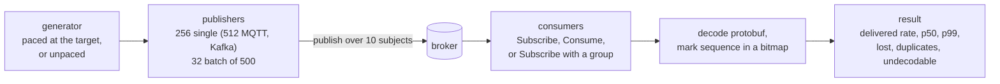

### Scenarios

| Scenario | Publish | Receive |
| --- | --- | --- |
| fanout | `Publish`, one message per call | `Subscribe` |
| batch | `PublishBatch`, 500 per call | `Subscribe` |
| durable | `Publish` | `Consume` with ack |
| group | `Publish` | `Subscribe` with `streams.Group`, consumers sharing each subject |

### Profiles

| Profile | Transport | Broker durability |
| --- | --- | --- |
| plain | plaintext | broker defaults |
| tls-prod | mutual TLS, authenticated | the broker's production default: flushed to disk on its own schedule |
| tls-strict | mutual TLS, authenticated | sync every message to disk before acknowledging |

### Network path

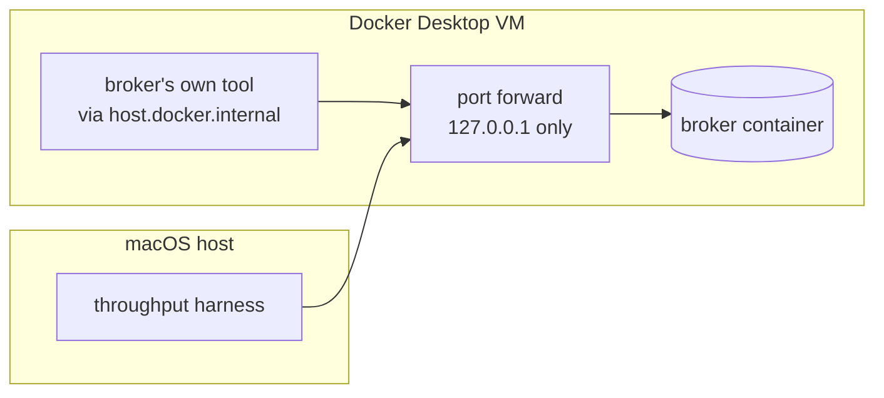

### Judging a run

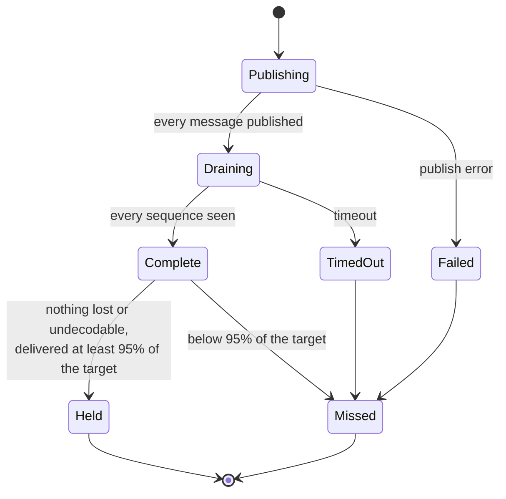

## Targets held

| Target | Held | Runs |
| --- | ---: | ---: |
| 20,000 msg/s | 52 | 56 |
| 50,000 msg/s | 50 | 56 |
| 100,000 msg/s | 31 | 56 |

## Delivered rate, msg/s

`no` marks a run that did not hold its target.

| Backend | Profile | Scenario | 20k | 50k | 100k | Unpaced | p50 ms at 50k | p99 ms at 50k | Duplicates |
| --- | --- | --- | ---: | ---: | ---: | ---: | ---: | ---: | ---: |
| ZeroMQ | Plaintext | fanout | 19,956 | 49,890 | 99,780 | 641,451 | 0.0 | 0.1 | 0 |
| ZeroMQ | Plaintext | batch | 20,045 | 49,962 | 99,837 | 648,389 |  |  | 0 |
| NATS core | Plaintext | fanout | 19,956 | 49,890 | 99,778 | 395,264 | 0.4 | 1.8 | 0 |
| NATS core | Plaintext | batch | 20,053 | 49,965 | 99,863 | 1,206,699 |  |  | 0 |
| NATS core | Plaintext | group | 19,959 | 49,890 | 99,791 | 398,707 | 0.4 | 1.7 | 0 |
| NATS core | TLS, production durability | fanout | 19,960 | 49,891 | 99,779 | 250,892 | 0.4 | 2.1 | 0 |
| NATS core | TLS, production durability | batch | 20,045 | 49,966 | 99,865 | 1,045,607 |  |  | 0 |
| NATS core | TLS, production durability | group | 19,956 | 49,897 | 99,795 | 374,635 | 0.4 | 1.7 | 0 |
| NATS core | TLS, sync every message | fanout |  |  |  | 322,025 |  |  | 0 |
| NATS core | TLS, sync every message | batch |  |  |  | 389,524 |  |  | 0 |
| NATS core | TLS, sync every message | group |  |  |  | 281,822 |  |  | 0 |
| NATS JetStream | Plaintext | fanout | 19,957 | 49,884 | 85,587 no | 83,895 | 0.8 | 6.4 | 0 |
| NATS JetStream | Plaintext | batch | 20,028 | 49,945 | 99,797 | 130,255 |  |  | 0 |
| NATS JetStream | Plaintext | durable | 19,958 | 49,882 | 79,731 no | 59,966 | 1.0 | 5.8 | 0 |
| NATS JetStream | TLS, production durability | fanout | 19,999 | 49,739 | 83,607 no | 81,644 | 0.9 | 8.8 | 0 |
| NATS JetStream | TLS, production durability | batch | 20,026 | 49,954 | 95,073 | 128,523 |  |  | 0 |
| NATS JetStream | TLS, production durability | durable | 19,954 | 49,883 | 77,522 no | 79,286 | 1.1 | 6.7 | 0 |
| NATS JetStream | TLS, sync every message | fanout |  |  |  | 1,950 |  |  | 0 |
| NATS JetStream | TLS, sync every message | batch |  |  |  | 1,693 |  |  | 0 |
| NATS JetStream | TLS, sync every message | durable |  |  |  | 1,680 |  |  | 0 |
| Redis pub/sub | Plaintext | fanout | 19,997 | 49,987 | 99,705 | 113,792 | 2.5 | 11.2 | 0 |
| Redis pub/sub | Plaintext | batch | 20,049 | 49,976 | 99,834 | 732,591 |  |  | 0 |
| Redis pub/sub | TLS, production durability | fanout | 19,995 | 49,882 | 99,962 | 122,319 | 2.7 | 5.7 | 0 |
| Redis pub/sub | TLS, production durability | batch | 20,047 | 49,969 | 99,853 | 701,911 |  |  | 0 |
| Redis pub/sub | TLS, sync every message | fanout |  |  |  | 106,966 |  |  | 0 |
| Redis pub/sub | TLS, sync every message | batch |  |  |  | 214,970 |  |  | 0 |
| Redis Streams | Plaintext | fanout | 19,952 | 49,882 | 99,762 | 148,146 | 3.3 | 6.5 | 0 |
| Redis Streams | Plaintext | batch | 20,047 | 49,971 | 99,862 | 544,402 |  |  | 0 |
| Redis Streams | Plaintext | durable | 19,952 | 49,883 | 99,744 | 123,310 | 4.0 | 7.6 | 0 |
| Redis Streams | TLS, production durability | fanout | 19,955 | 49,874 | 99,743 | 122,890 | 3.7 | 7.6 | 0 |
| Redis Streams | TLS, production durability | batch | 20,042 | 49,964 | 99,847 | 385,115 |  |  | 0 |
| Redis Streams | TLS, production durability | durable | 19,952 | 49,861 | 92,198 no | 89,786 | 4.8 | 9.1 | 0 |
| Redis Streams | TLS, sync every message | fanout |  |  |  | 34,553 |  |  | 0 |
| Redis Streams | TLS, sync every message | batch |  |  |  | 138,141 |  |  | 0 |
| Redis Streams | TLS, sync every message | durable |  |  |  | 26,408 |  |  | 0 |
| Kafka | Plaintext | fanout | 19,947 | 49,866 | 99,753 | 165,682 | 3.3 | 50.3 | 0 |
| Kafka | Plaintext | batch | 20,015 | 49,958 | 99,830 | 1,497,463 |  |  | 0 |
| Kafka | Plaintext | durable | 19,947 | 49,864 | 99,729 | 141,059 | 4.2 | 494.9 | 32 |
| Kafka | Plaintext | group | 19,951 | 49,868 | 99,694 | 152,366 | 3.2 | 10.3 | 0 |
| Kafka | TLS, production durability | fanout | 19,954 | 49,870 | 99,729 | 174,469 | 3.4 | 28.0 | 0 |
| Kafka | TLS, production durability | batch | 20,035 | 49,952 | 99,833 | 1,486,089 |  |  | 0 |
| Kafka | TLS, production durability | durable | 19,949 | 49,861 | 99,685 | 127,350 | 4.3 | 494.5 | 161 |
| Kafka | TLS, production durability | group | 19,943 | 49,871 | 99,725 | 161,861 | 3.3 | 15.5 | 0 |
| Kafka | TLS, sync every message | fanout |  |  |  | 7,213 |  |  | 0 |
| Kafka | TLS, sync every message | batch |  |  |  | 296,958 |  |  | 0 |
| Kafka | TLS, sync every message | durable |  |  |  | 5,250 |  |  | 35 |
| Kafka | TLS, sync every message | group |  |  |  | 8,268 |  |  | 0 |
| RabbitMQ | Plaintext | fanout | 19,955 | 49,887 | 75,612 no | 74,993 | 1.4 | 6.1 | 0 |
| RabbitMQ | Plaintext | batch | 20,026 | 49,919 | 91,911 no | 99,038 |  |  | 0 |
| RabbitMQ | Plaintext | durable | 19,993 | 49,703 | 54,105 no | 54,130 | 3.0 | 11.7 | 0 |
| RabbitMQ | TLS, production durability | fanout | 19,996 | 49,876 | 68,185 no | 69,196 | 2.0 | 6.4 | 0 |
| RabbitMQ | TLS, production durability | batch | 20,008 | 49,868 | 90,173 no | 92,015 |  |  | 0 |
| RabbitMQ | TLS, production durability | durable | 19,992 | 48,839 | 49,497 no | 36,818 | 4.0 | 11.3 | 0 |
| RabbitMQ | TLS, sync every message | fanout |  |  |  | 67,029 |  |  | 0 |
| RabbitMQ | TLS, sync every message | batch |  |  |  | 94,736 |  |  | 0 |
| RabbitMQ | TLS, sync every message | durable |  |  |  | 50,047 |  |  | 0 |
| MQTT | Plaintext | fanout | 19,837 | 49,497 | 89,678 no | 89,586 | 1.2 | 3.9 | 0 |
| MQTT | Plaintext | batch | 19,921 | 49,664 | 99,231 | 110,820 |  |  | 0 |
| MQTT | Plaintext | durable | 19,839 | 49,592 | 89,183 no | 86,088 | 1.2 | 7.3 | 76 |
| MQTT | Plaintext | group | 19,834 | 49,463 | 84,274 no | 86,709 | 1.7 | 6.8 | 0 |
| MQTT | TLS, production durability | fanout | 19,838 | 49,590 | 71,349 no | 69,063 | 7.7 | 13.6 | 0 |
| MQTT | TLS, production durability | batch | 19,911 | 49,647 | 98,842 | 121,188 |  |  | 0 |
| MQTT | TLS, production durability | durable | 19,837 | 49,548 | 66,828 no | 66,541 | 8.4 | 15.9 | 183 |
| MQTT | TLS, production durability | group | 19,837 | 49,425 | 63,677 no | 69,097 | 9.1 | 16.1 | 0 |
| MQTT | TLS, sync every message | fanout |  |  |  | 42,530 |  |  | 0 |
| MQTT | TLS, sync every message | batch |  |  |  | 74,186 |  |  | 0 |
| MQTT | TLS, sync every message | durable |  |  |  | 50,503 |  |  | 0 |
| MQTT | TLS, sync every message | group |  |  |  | 45,883 |  |  | 0 |
| OPC UA client/server | Plaintext | fanout | 14,126 no | 14,829 no | 14,580 no | 14,723 | 58.1 | 116.0 | 0 |
| OPC UA client/server | Plaintext | batch | 14,431 no | 14,558 no | 14,583 no | 14,673 | 53.6 | 102.5 | 0 |
| OPC UA client/server | TLS, production durability | fanout | 12,689 no | 13,331 no | 13,265 no | 13,242 | 56.8 | 115.4 | 0 |
| OPC UA client/server | TLS, production durability | batch | 13,114 no | 13,248 no | 13,132 no | 13,381 | 52.3 | 101.3 | 0 |
| OPC UA PubSub | Plaintext | fanout | 19,830 | 49,568 | 62,433 no | 63,347 | 2.5 | 8.5 | 0 |
| OPC UA PubSub | Plaintext | batch | 20,034 | 49,955 | 99,756 | 424,235 | 2.9 | 6.2 | 0 |
| OPC UA PubSub | Plaintext | group | 19,836 | 49,564 | 58,800 no | 59,509 | 3.1 | 9.2 | 0 |
| OPC UA PubSub | TLS, production durability | fanout | 19,829 | 37,411 no | 38,948 no | 38,602 | 5.9 | 17.2 | 0 |
| OPC UA PubSub | TLS, production durability | batch | 20,039 | 49,944 | 99,818 | 393,978 | 3.0 | 6.7 | 0 |
| OPC UA PubSub | TLS, production durability | group | 19,836 | 36,142 no | 35,419 no | 36,678 | 6.1 | 18.0 | 0 |
| OPC UA PubSub | TLS, sync every message | fanout |  |  |  | 37,755 |  |  | 0 |
| OPC UA PubSub | TLS, sync every message | batch |  |  |  | 108,196 |  |  | 0 |
| OPC UA PubSub | TLS, sync every message | group |  |  |  | 31,801 |  |  | 0 |

### Unpaced fanout, plaintext, msg/s

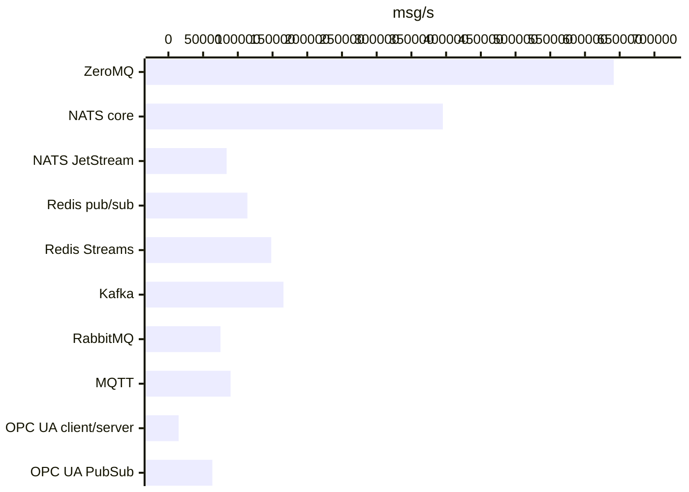

### Unpaced batch, plaintext, msg/s

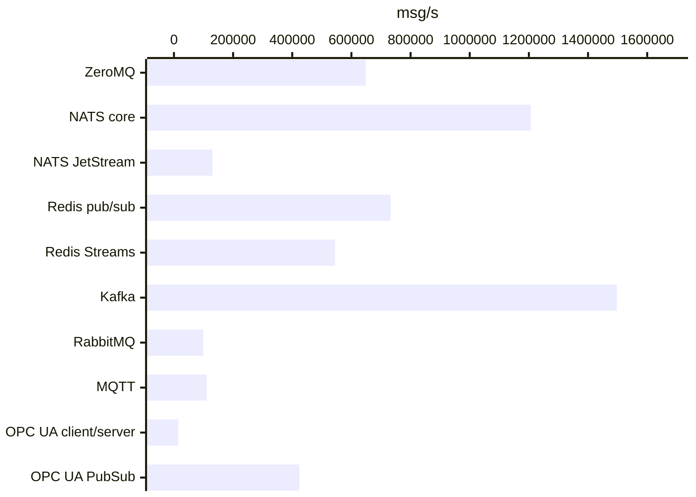

### Unpaced durable, plaintext, msg/s

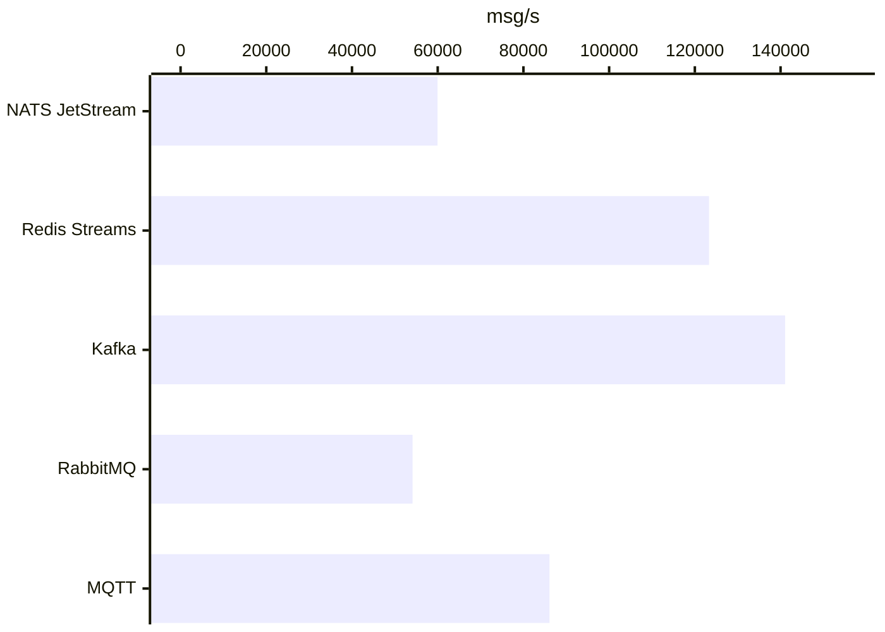

### Unpaced fanout, tls, production durability, msg/s

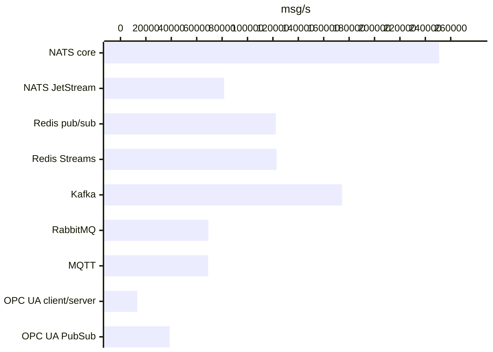

### Unpaced batch, tls, production durability, msg/s

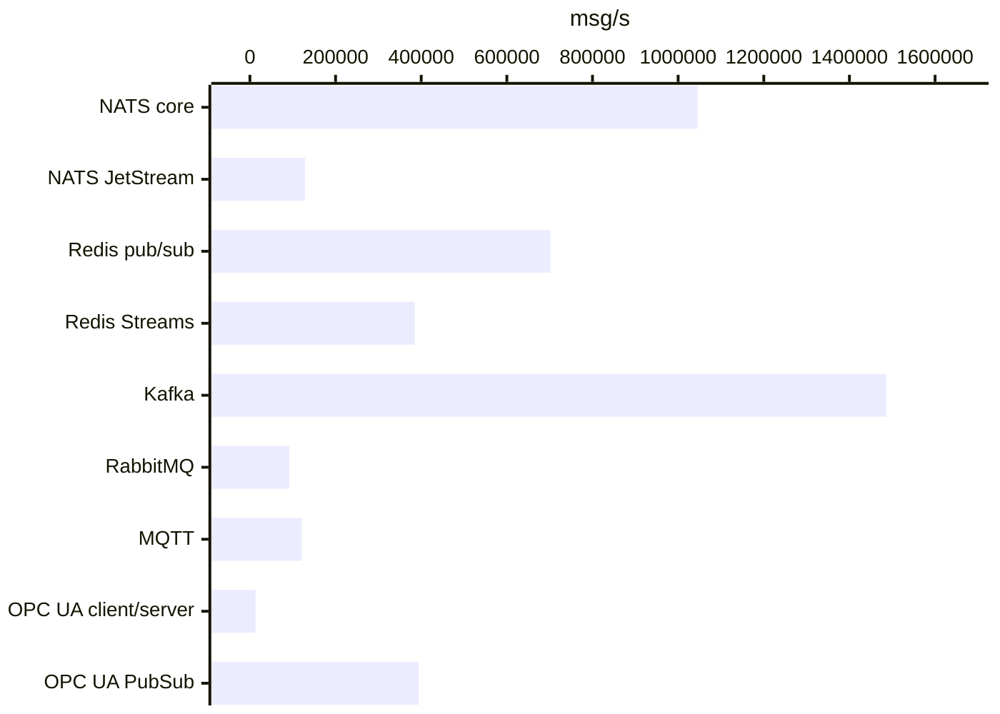

### Unpaced durable, tls, production durability, msg/s

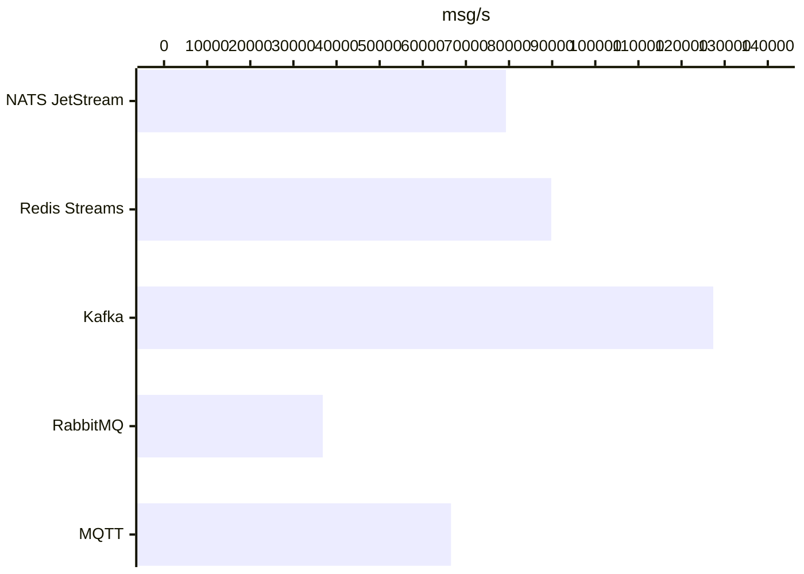

## Go against Rust

Go: label `go-official,go-official-mqttfix,go-official-fix2,go-official-fix3`. Rust: runtime-rs `target/bench-results.jsonl`, label `official-final,official-fix2`. Latest run per backend, profile, scenario and target on each side. Same matrix, brokers, compose files and machine; runs at different times.

### Targets held

| Target | Go held | Go runs | Rust held | Rust runs |
| --- | ---: | ---: | ---: | ---: |
| 20,000 msg/s | 52 | 56 | 52 | 56 |
| 50,000 msg/s | 50 | 56 | 49 | 56 |
| 100,000 msg/s | 31 | 56 | 30 | 56 |
| runs ok, all targets and unpaced | 249 | 249 | 248 | 249 |

### Targets held per backend

| Backend | Go held | Rust held | Runs (paced) |
| --- | ---: | ---: | ---: |
| ZeroMQ | 6 | 6 | 6 |
| NATS core | 18 | 18 | 18 |
| NATS JetStream | 14 | 15 | 18 |
| Redis pub/sub | 12 | 11 | 12 |
| Redis Streams | 17 | 18 | 18 |
| Kafka | 24 | 16 | 24 |
| RabbitMQ | 12 | 14 | 18 |
| MQTT | 18 | 19 | 24 |
| OPC UA client/server | 0 | 0 | 12 |
| OPC UA PubSub | 12 | 14 | 18 |

### Delivered rate

`no` marks a run that did not hold its target. Go ÷ Rust is delivered msg/s.

| Backend | Profile | Scenario | Target | Go msg/s | Rust msg/s | Go ÷ Rust |
| --- | --- | --- | --- | ---: | ---: | ---: |
| ZeroMQ | plain | fanout | 20k | 19,956 | 19,943 | 1.00 |
| ZeroMQ | plain | fanout | 50k | 49,890 | 49,862 | 1.00 |
| ZeroMQ | plain | fanout | 100k | 99,780 | 99,729 | 1.00 |
| ZeroMQ | plain | fanout | unpaced | 641,451 | 633,401 | 1.01 |
| ZeroMQ | plain | batch | 20k | 20,045 | 20,034 | 1.00 |
| ZeroMQ | plain | batch | 50k | 49,962 | 49,934 | 1.00 |
| ZeroMQ | plain | batch | 100k | 99,837 | 99,793 | 1.00 |
| ZeroMQ | plain | batch | unpaced | 648,389 | 69,734 no | 9.30 |
| NATS core | plain | fanout | 20k | 19,956 | 19,947 | 1.00 |
| NATS core | plain | fanout | 50k | 49,890 | 49,868 | 1.00 |
| NATS core | plain | fanout | 100k | 99,778 | 99,757 | 1.00 |
| NATS core | plain | fanout | unpaced | 395,264 | 450,360 | 0.88 |
| NATS core | plain | batch | 20k | 20,053 | 20,046 | 1.00 |
| NATS core | plain | batch | 50k | 49,965 | 49,958 | 1.00 |
| NATS core | plain | batch | 100k | 99,863 | 99,804 | 1.00 |
| NATS core | plain | batch | unpaced | 1,206,699 | 1,323,559 | 0.91 |
| NATS core | plain | group | 20k | 19,959 | 19,949 | 1.00 |
| NATS core | plain | group | 50k | 49,890 | 49,869 | 1.00 |
| NATS core | plain | group | 100k | 99,791 | 99,739 | 1.00 |
| NATS core | plain | group | unpaced | 398,707 | 447,218 | 0.89 |
| NATS core | tls-prod | fanout | 20k | 19,960 | 19,915 | 1.00 |
| NATS core | tls-prod | fanout | 50k | 49,891 | 49,871 | 1.00 |
| NATS core | tls-prod | fanout | 100k | 99,779 | 99,727 | 1.00 |
| NATS core | tls-prod | fanout | unpaced | 250,892 | 404,670 | 0.62 |
| NATS core | tls-prod | batch | 20k | 20,045 | 20,044 | 1.00 |
| NATS core | tls-prod | batch | 50k | 49,966 | 49,958 | 1.00 |
| NATS core | tls-prod | batch | 100k | 99,865 | 99,836 | 1.00 |
| NATS core | tls-prod | batch | unpaced | 1,045,607 | 1,467,284 | 0.71 |
| NATS core | tls-prod | group | 20k | 19,956 | 19,947 | 1.00 |
| NATS core | tls-prod | group | 50k | 49,897 | 49,883 | 1.00 |
| NATS core | tls-prod | group | 100k | 99,795 | 99,741 | 1.00 |
| NATS core | tls-prod | group | unpaced | 374,635 | 394,826 | 0.95 |
| NATS core | tls-strict | fanout | unpaced | 322,025 | 247,343 | 1.30 |
| NATS core | tls-strict | batch | unpaced | 389,524 | 581,414 | 0.67 |
| NATS core | tls-strict | group | unpaced | 281,822 | 273,135 | 1.03 |
| NATS JetStream | plain | fanout | 20k | 19,957 | 19,946 | 1.00 |
| NATS JetStream | plain | fanout | 50k | 49,884 | 49,982 | 1.00 |
| NATS JetStream | plain | fanout | 100k | 85,587 no | 95,490 | 0.90 |
| NATS JetStream | plain | fanout | unpaced | 83,895 | 97,964 | 0.86 |
| NATS JetStream | plain | batch | 20k | 20,028 | 20,020 | 1.00 |
| NATS JetStream | plain | batch | 50k | 49,945 | 49,917 | 1.00 |
| NATS JetStream | plain | batch | 100k | 99,797 | 99,736 | 1.00 |
| NATS JetStream | plain | batch | unpaced | 130,255 | 124,506 | 1.05 |
| NATS JetStream | plain | durable | 20k | 19,958 | 19,952 | 1.00 |
| NATS JetStream | plain | durable | 50k | 49,882 | 49,883 | 1.00 |
| NATS JetStream | plain | durable | 100k | 79,731 no | 92,111 no | 0.87 |
| NATS JetStream | plain | durable | unpaced | 59,966 | 91,506 | 0.66 |
| NATS JetStream | tls-prod | fanout | 20k | 19,999 | 19,951 | 1.00 |
| NATS JetStream | tls-prod | fanout | 50k | 49,739 | 49,871 | 1.00 |
| NATS JetStream | tls-prod | fanout | 100k | 83,607 no | 92,153 no | 0.91 |
| NATS JetStream | tls-prod | fanout | unpaced | 81,644 | 91,628 | 0.89 |
| NATS JetStream | tls-prod | batch | 20k | 20,026 | 20,027 | 1.00 |
| NATS JetStream | tls-prod | batch | 50k | 49,954 | 49,912 | 1.00 |
| NATS JetStream | tls-prod | batch | 100k | 95,073 | 99,950 | 0.95 |
| NATS JetStream | tls-prod | batch | unpaced | 128,523 | 125,000 | 1.03 |
| NATS JetStream | tls-prod | durable | 20k | 19,954 | 19,950 | 1.00 |
| NATS JetStream | tls-prod | durable | 50k | 49,883 | 49,982 | 1.00 |
| NATS JetStream | tls-prod | durable | 100k | 77,522 no | 81,949 no | 0.95 |
| NATS JetStream | tls-prod | durable | unpaced | 79,286 | 81,428 | 0.97 |
| NATS JetStream | tls-strict | fanout | unpaced | 1,950 | 2,037 | 0.96 |
| NATS JetStream | tls-strict | batch | unpaced | 1,693 | 2,133 | 0.79 |
| NATS JetStream | tls-strict | durable | unpaced | 1,680 | 1,744 | 0.96 |
| Redis pub/sub | plain | fanout | 20k | 19,997 | 19,993 | 1.00 |
| Redis pub/sub | plain | fanout | 50k | 49,987 | 49,984 | 1.00 |
| Redis pub/sub | plain | fanout | 100k | 99,705 | 99,925 | 1.00 |
| Redis pub/sub | plain | fanout | unpaced | 113,792 | 174,197 | 0.65 |
| Redis pub/sub | plain | batch | 20k | 20,049 | 20,033 | 1.00 |
| Redis pub/sub | plain | batch | 50k | 49,976 | 49,946 | 1.00 |
| Redis pub/sub | plain | batch | 100k | 99,834 | 99,794 | 1.00 |
| Redis pub/sub | plain | batch | unpaced | 732,591 | 842,238 | 0.87 |
| Redis pub/sub | tls-prod | fanout | 20k | 19,995 | 19,995 | 1.00 |
| Redis pub/sub | tls-prod | fanout | 50k | 49,882 | 49,988 | 1.00 |
| Redis pub/sub | tls-prod | fanout | 100k | 99,962 | 72,083 no | 1.39 |
| Redis pub/sub | tls-prod | fanout | unpaced | 122,319 | 75,432 | 1.62 |
| Redis pub/sub | tls-prod | batch | 20k | 20,047 | 20,033 | 1.00 |
| Redis pub/sub | tls-prod | batch | 50k | 49,969 | 49,950 | 1.00 |
| Redis pub/sub | tls-prod | batch | 100k | 99,853 | 99,822 | 1.00 |
| Redis pub/sub | tls-prod | batch | unpaced | 701,911 | 702,616 | 1.00 |
| Redis pub/sub | tls-strict | fanout | unpaced | 106,966 | 50,465 | 2.12 |
| Redis pub/sub | tls-strict | batch | unpaced | 214,970 | 425,774 | 0.50 |
| Redis Streams | plain | fanout | 20k | 19,952 | 19,947 | 1.00 |
| Redis Streams | plain | fanout | 50k | 49,882 | 49,882 | 1.00 |
| Redis Streams | plain | fanout | 100k | 99,762 | 99,729 | 1.00 |
| Redis Streams | plain | fanout | unpaced | 148,146 | 212,858 | 0.70 |
| Redis Streams | plain | batch | 20k | 20,047 | 20,031 | 1.00 |
| Redis Streams | plain | batch | 50k | 49,971 | 49,932 | 1.00 |
| Redis Streams | plain | batch | 100k | 99,862 | 99,799 | 1.00 |
| Redis Streams | plain | batch | unpaced | 544,402 | 604,063 | 0.90 |
| Redis Streams | plain | durable | 20k | 19,952 | 19,950 | 1.00 |
| Redis Streams | plain | durable | 50k | 49,883 | 49,863 | 1.00 |
| Redis Streams | plain | durable | 100k | 99,744 | 99,715 | 1.00 |
| Redis Streams | plain | durable | unpaced | 123,310 | 196,413 | 0.63 |
| Redis Streams | tls-prod | fanout | 20k | 19,955 | 19,995 | 1.00 |
| Redis Streams | tls-prod | fanout | 50k | 49,874 | 49,877 | 1.00 |
| Redis Streams | tls-prod | fanout | 100k | 99,743 | 99,745 | 1.00 |
| Redis Streams | tls-prod | fanout | unpaced | 122,890 | 177,260 | 0.69 |
| Redis Streams | tls-prod | batch | 20k | 20,042 | 20,032 | 1.00 |
| Redis Streams | tls-prod | batch | 50k | 49,964 | 49,942 | 1.00 |
| Redis Streams | tls-prod | batch | 100k | 99,847 | 99,818 | 1.00 |
| Redis Streams | tls-prod | batch | unpaced | 385,115 | 478,006 | 0.81 |
| Redis Streams | tls-prod | durable | 20k | 19,952 | 19,949 | 1.00 |
| Redis Streams | tls-prod | durable | 50k | 49,861 | 49,855 | 1.00 |
| Redis Streams | tls-prod | durable | 100k | 92,198 no | 99,420 | 0.93 |
| Redis Streams | tls-prod | durable | unpaced | 89,786 | 134,636 | 0.67 |
| Redis Streams | tls-strict | fanout | unpaced | 34,553 | 23,250 | 1.49 |
| Redis Streams | tls-strict | batch | unpaced | 138,141 | 232,007 | 0.60 |
| Redis Streams | tls-strict | durable | unpaced | 26,408 | 20,545 | 1.29 |
| Kafka | plain | fanout | 20k | 19,947 | 19,936 | 1.00 |
| Kafka | plain | fanout | 50k | 49,866 | 49,814 | 1.00 |
| Kafka | plain | fanout | 100k | 99,753 | 72,183 no | 1.38 |
| Kafka | plain | fanout | unpaced | 165,682 | 69,513 | 2.38 |
| Kafka | plain | batch | 20k | 20,015 | 20,028 | 1.00 |
| Kafka | plain | batch | 50k | 49,958 | 49,928 | 1.00 |
| Kafka | plain | batch | 100k | 99,830 | 99,755 | 1.00 |
| Kafka | plain | batch | unpaced | 1,497,463 | 1,118,949 | 1.34 |
| Kafka | plain | durable | 20k | 19,947 | 19,916 | 1.00 |
| Kafka | plain | durable | 50k | 49,864 | 44,252 no | 1.13 |
| Kafka | plain | durable | 100k | 99,729 | 44,303 no | 2.25 |
| Kafka | plain | durable | unpaced | 141,059 | 47,321 | 2.98 |
| Kafka | plain | group | 20k | 19,951 | 19,932 | 1.00 |
| Kafka | plain | group | 50k | 49,868 | 49,763 | 1.00 |
| Kafka | plain | group | 100k | 99,694 | 77,610 no | 1.28 |
| Kafka | plain | group | unpaced | 152,366 | 75,921 | 2.01 |
| Kafka | tls-prod | fanout | 20k | 19,954 | 19,939 | 1.00 |
| Kafka | tls-prod | fanout | 50k | 49,870 | 49,767 | 1.00 |
| Kafka | tls-prod | fanout | 100k | 99,729 | 57,298 no | 1.74 |
| Kafka | tls-prod | fanout | unpaced | 174,469 | 53,147 | 3.28 |
| Kafka | tls-prod | batch | 20k | 20,035 | 20,021 | 1.00 |
| Kafka | tls-prod | batch | 50k | 49,952 | 49,893 | 1.00 |
| Kafka | tls-prod | batch | 100k | 99,833 | 99,772 | 1.00 |
| Kafka | tls-prod | batch | unpaced | 1,486,089 | 585,784 | 2.54 |
| Kafka | tls-prod | durable | 20k | 19,949 | 19,920 | 1.00 |
| Kafka | tls-prod | durable | 50k | 49,861 | 38,023 no | 1.31 |
| Kafka | tls-prod | durable | 100k | 99,685 | 38,672 no | 2.58 |
| Kafka | tls-prod | durable | unpaced | 127,350 | 34,739 | 3.67 |
| Kafka | tls-prod | group | 20k | 19,943 | 19,933 | 1.00 |
| Kafka | tls-prod | group | 50k | 49,871 | 47,950 | 1.04 |
| Kafka | tls-prod | group | 100k | 99,725 | 56,231 no | 1.77 |
| Kafka | tls-prod | group | unpaced | 161,861 | 54,445 | 2.97 |
| Kafka | tls-strict | fanout | unpaced | 7,213 | 4,938 | 1.46 |
| Kafka | tls-strict | batch | unpaced | 296,958 | 67,592 | 4.39 |
| Kafka | tls-strict | durable | unpaced | 5,250 | 3,274 | 1.60 |
| Kafka | tls-strict | group | unpaced | 8,268 | 7,477 | 1.11 |
| RabbitMQ | plain | fanout | 20k | 19,955 | 19,946 | 1.00 |
| RabbitMQ | plain | fanout | 50k | 49,887 | 49,988 | 1.00 |
| RabbitMQ | plain | fanout | 100k | 75,612 no | 99,492 | 0.76 |
| RabbitMQ | plain | fanout | unpaced | 74,993 | 97,896 | 0.77 |
| RabbitMQ | plain | batch | 20k | 20,026 | 20,059 | 1.00 |
| RabbitMQ | plain | batch | 50k | 49,919 | 50,014 | 1.00 |
| RabbitMQ | plain | batch | 100k | 91,911 no | 99,954 | 0.92 |
| RabbitMQ | plain | batch | unpaced | 99,038 | 171,349 | 0.58 |
| RabbitMQ | plain | durable | 20k | 19,993 | 19,985 | 1.00 |
| RabbitMQ | plain | durable | 50k | 49,703 | 41,009 no | 1.21 |
| RabbitMQ | plain | durable | 100k | 54,105 no | 52,962 no | 1.02 |
| RabbitMQ | plain | durable | unpaced | 54,130 | 52,899 | 1.02 |
| RabbitMQ | tls-prod | fanout | 20k | 19,996 | 19,991 | 1.00 |
| RabbitMQ | tls-prod | fanout | 50k | 49,876 | 49,853 | 1.00 |
| RabbitMQ | tls-prod | fanout | 100k | 68,185 no | 92,951 no | 0.73 |
| RabbitMQ | tls-prod | fanout | unpaced | 69,196 | 94,074 | 0.74 |
| RabbitMQ | tls-prod | batch | 20k | 20,008 | 20,057 | 1.00 |
| RabbitMQ | tls-prod | batch | 50k | 49,868 | 50,017 | 1.00 |
| RabbitMQ | tls-prod | batch | 100k | 90,173 no | 99,961 | 0.90 |
| RabbitMQ | tls-prod | batch | unpaced | 92,015 | 173,770 | 0.53 |
| RabbitMQ | tls-prod | durable | 20k | 19,992 | 19,983 | 1.00 |
| RabbitMQ | tls-prod | durable | 50k | 48,839 | 49,464 | 0.99 |
| RabbitMQ | tls-prod | durable | 100k | 49,497 no | 52,556 no | 0.94 |
| RabbitMQ | tls-prod | durable | unpaced | 36,818 | 51,918 | 0.71 |
| RabbitMQ | tls-strict | fanout | unpaced | 67,029 | 87,744 | 0.76 |
| RabbitMQ | tls-strict | batch | unpaced | 94,736 | 126,576 | 0.75 |
| RabbitMQ | tls-strict | durable | unpaced | 50,047 | 56,292 | 0.89 |
| MQTT | plain | fanout | 20k | 19,837 | 19,829 | 1.00 |
| MQTT | plain | fanout | 50k | 49,497 | 49,583 | 1.00 |
| MQTT | plain | fanout | 100k | 89,678 no | 95,116 | 0.94 |
| MQTT | plain | fanout | unpaced | 89,586 | 96,232 | 0.93 |
| MQTT | plain | batch | 20k | 19,921 | 19,902 | 1.00 |
| MQTT | plain | batch | 50k | 49,664 | 49,632 | 1.00 |
| MQTT | plain | batch | 100k | 99,231 | 99,185 | 1.00 |
| MQTT | plain | batch | unpaced | 110,820 | 220,965 | 0.50 |
| MQTT | plain | durable | 20k | 19,839 | 19,822 | 1.00 |
| MQTT | plain | durable | 50k | 49,592 | 49,586 | 1.00 |
| MQTT | plain | durable | 100k | 89,183 no | 88,383 no | 1.01 |
| MQTT | plain | durable | unpaced | 86,088 | 83,275 | 1.03 |
| MQTT | plain | group | 20k | 19,834 | 19,829 | 1.00 |
| MQTT | plain | group | 50k | 49,463 | 49,576 | 1.00 |
| MQTT | plain | group | 100k | 84,274 no | 82,487 no | 1.02 |
| MQTT | plain | group | unpaced | 86,709 | 85,810 | 1.01 |
| MQTT | tls-prod | fanout | 20k | 19,838 | 19,834 | 1.00 |
| MQTT | tls-prod | fanout | 50k | 49,590 | 49,327 | 1.01 |
| MQTT | tls-prod | fanout | 100k | 71,349 no | 80,839 no | 0.88 |
| MQTT | tls-prod | fanout | unpaced | 69,063 | 73,652 | 0.94 |
| MQTT | tls-prod | batch | 20k | 19,911 | 19,896 | 1.00 |
| MQTT | tls-prod | batch | 50k | 49,647 | 49,611 | 1.00 |
| MQTT | tls-prod | batch | 100k | 98,842 | 99,137 | 1.00 |
| MQTT | tls-prod | batch | unpaced | 121,188 | 111,480 | 1.09 |
| MQTT | tls-prod | durable | 20k | 19,837 | 19,832 | 1.00 |
| MQTT | tls-prod | durable | 50k | 49,548 | 49,558 | 1.00 |
| MQTT | tls-prod | durable | 100k | 66,828 no | 75,931 no | 0.88 |
| MQTT | tls-prod | durable | unpaced | 66,541 | 81,779 | 0.81 |
| MQTT | tls-prod | group | 20k | 19,837 | 19,834 | 1.00 |
| MQTT | tls-prod | group | 50k | 49,425 | 49,125 | 1.01 |
| MQTT | tls-prod | group | 100k | 63,677 no | 91,756 no | 0.69 |
| MQTT | tls-prod | group | unpaced | 69,097 | 92,737 | 0.75 |
| MQTT | tls-strict | fanout | unpaced | 42,530 | 53,313 | 0.80 |
| MQTT | tls-strict | batch | unpaced | 74,186 | 83,671 | 0.89 |
| MQTT | tls-strict | durable | unpaced | 50,503 | 50,240 | 1.01 |
| MQTT | tls-strict | group | unpaced | 45,883 | 48,816 | 0.94 |
| OPC UA client/server | plain | fanout | 20k | 14,126 no | 15,061 no | 0.94 |
| OPC UA client/server | plain | fanout | 50k | 14,829 no | 15,718 no | 0.94 |
| OPC UA client/server | plain | fanout | 100k | 14,580 no | 15,264 no | 0.96 |
| OPC UA client/server | plain | fanout | unpaced | 14,723 | 15,084 | 0.98 |
| OPC UA client/server | plain | batch | 20k | 14,431 no | 14,704 no | 0.98 |
| OPC UA client/server | plain | batch | 50k | 14,558 no | 15,142 no | 0.96 |
| OPC UA client/server | plain | batch | 100k | 14,583 no | 15,183 no | 0.96 |
| OPC UA client/server | plain | batch | unpaced | 14,673 | 15,437 | 0.95 |
| OPC UA client/server | tls-prod | fanout | 20k | 12,689 no | 12,880 no | 0.99 |
| OPC UA client/server | tls-prod | fanout | 50k | 13,331 no | 13,823 no | 0.96 |
| OPC UA client/server | tls-prod | fanout | 100k | 13,265 no | 13,794 no | 0.96 |
| OPC UA client/server | tls-prod | fanout | unpaced | 13,242 | 13,672 | 0.97 |
| OPC UA client/server | tls-prod | batch | 20k | 13,114 no | 13,526 no | 0.97 |
| OPC UA client/server | tls-prod | batch | 50k | 13,248 no | 13,572 no | 0.98 |
| OPC UA client/server | tls-prod | batch | 100k | 13,132 no | 13,650 no | 0.96 |
| OPC UA client/server | tls-prod | batch | unpaced | 13,381 | 13,641 | 0.98 |
| OPC UA PubSub | plain | fanout | 20k | 19,830 | 19,827 | 1.00 |
| OPC UA PubSub | plain | fanout | 50k | 49,568 | 49,543 | 1.00 |
| OPC UA PubSub | plain | fanout | 100k | 62,433 no | 70,348 no | 0.89 |
| OPC UA PubSub | plain | fanout | unpaced | 63,347 | 70,434 | 0.90 |
| OPC UA PubSub | plain | batch | 20k | 20,034 | 19,915 | 1.01 |
| OPC UA PubSub | plain | batch | 50k | 49,955 | 49,654 | 1.01 |
| OPC UA PubSub | plain | batch | 100k | 99,756 | 99,206 | 1.01 |
| OPC UA PubSub | plain | batch | unpaced | 424,235 | 598,421 | 0.71 |
| OPC UA PubSub | plain | group | 20k | 19,836 | 19,831 | 1.00 |
| OPC UA PubSub | plain | group | 50k | 49,564 | 49,578 | 1.00 |
| OPC UA PubSub | plain | group | 100k | 58,800 no | 65,868 no | 0.89 |
| OPC UA PubSub | plain | group | unpaced | 59,509 | 62,620 | 0.95 |
| OPC UA PubSub | tls-prod | fanout | 20k | 19,829 | 19,828 | 1.00 |
| OPC UA PubSub | tls-prod | fanout | 50k | 37,411 no | 49,581 | 0.75 |
| OPC UA PubSub | tls-prod | fanout | 100k | 38,948 no | 81,160 no | 0.48 |
| OPC UA PubSub | tls-prod | fanout | unpaced | 38,602 | 82,360 | 0.47 |
| OPC UA PubSub | tls-prod | batch | 20k | 20,039 | 19,910 | 1.01 |
| OPC UA PubSub | tls-prod | batch | 50k | 49,944 | 49,666 | 1.01 |
| OPC UA PubSub | tls-prod | batch | 100k | 99,818 | 99,236 | 1.01 |
| OPC UA PubSub | tls-prod | batch | unpaced | 393,978 | 589,329 | 0.67 |
| OPC UA PubSub | tls-prod | group | 20k | 19,836 | 19,832 | 1.00 |
| OPC UA PubSub | tls-prod | group | 50k | 36,142 no | 49,579 | 0.73 |
| OPC UA PubSub | tls-prod | group | 100k | 35,419 no | 75,992 no | 0.47 |
| OPC UA PubSub | tls-prod | group | unpaced | 36,678 | 76,048 | 0.48 |
| OPC UA PubSub | tls-strict | fanout | unpaced | 37,755 | 40,825 | 0.92 |
| OPC UA PubSub | tls-strict | batch | unpaced | 108,196 | 231,077 | 0.47 |
| OPC UA PubSub | tls-strict | group | unpaced | 31,801 | 39,212 | 0.81 |

### Latency at 50,000 msg/s, ms

| Backend | Profile | Scenario | Go p50 | Rust p50 | Go p99 | Rust p99 |
| --- | --- | --- | ---: | ---: | ---: | ---: |
| ZeroMQ | plain | fanout | 0.0 | 0.3 | 0.1 | 2.2 |
| NATS core | plain | fanout | 0.4 | 0.5 | 1.8 | 2.8 |
| NATS core | plain | group | 0.4 | 0.5 | 1.7 | 2.4 |
| NATS core | tls-prod | fanout | 0.4 | 0.6 | 2.1 | 5.5 |
| NATS core | tls-prod | group | 0.4 | 0.5 | 1.7 | 2.0 |
| NATS JetStream | plain | fanout | 0.8 | 1.0 | 6.4 | 4.2 |
| NATS JetStream | plain | durable | 1.0 | 1.1 | 5.8 | 4.4 |
| NATS JetStream | tls-prod | fanout | 0.9 | 1.1 | 8.8 | 4.3 |
| NATS JetStream | tls-prod | durable | 1.1 | 1.1 | 6.7 | 4.9 |
| Redis pub/sub | plain | fanout | 2.5 | 0.7 | 11.2 | 3.1 |
| Redis pub/sub | tls-prod | fanout | 2.7 | 0.8 | 5.7 | 2.5 |
| Redis Streams | plain | fanout | 3.3 | 0.9 | 6.5 | 2.8 |
| Redis Streams | plain | durable | 4.0 | 2.5 | 7.6 | 5.3 |
| Redis Streams | tls-prod | fanout | 3.7 | 1.0 | 7.6 | 3.4 |
| Redis Streams | tls-prod | durable | 4.8 | 2.8 | 9.1 | 5.9 |
| Kafka | plain | fanout | 3.3 | 5.5 | 50.3 | 43.1 |
| Kafka | plain | durable | 4.2 | 11.2 | 494.9 | 41.3 |
| Kafka | plain | group | 3.2 | 11.5 | 10.3 | 1898.7 |
| Kafka | tls-prod | fanout | 3.4 | 7.1 | 28.0 | 63.8 |
| Kafka | tls-prod | durable | 4.3 | 12.5 | 494.5 | 59.4 |
| Kafka | tls-prod | group | 3.3 | 11.5 | 15.5 | 1455.5 |
| RabbitMQ | plain | fanout | 1.4 | 1.1 | 6.1 | 4.5 |
| RabbitMQ | plain | durable | 3.0 | 3.1 | 11.7 | 1414.4 |
| RabbitMQ | tls-prod | fanout | 2.0 | 1.4 | 6.4 | 4.8 |
| RabbitMQ | tls-prod | durable | 4.0 | 3.1 | 11.3 | 9.4 |
| MQTT | plain | fanout | 1.2 | 1.1 | 3.9 | 2.8 |
| MQTT | plain | durable | 1.2 | 1.2 | 7.3 | 3.8 |
| MQTT | plain | group | 1.7 | 1.4 | 6.8 | 5.1 |
| MQTT | tls-prod | fanout | 7.7 | 6.5 | 13.6 | 17.6 |
| MQTT | tls-prod | durable | 8.4 | 6.6 | 15.9 | 22.3 |
| MQTT | tls-prod | group | 9.1 | 1.8 | 16.1 | 21.5 |
| OPC UA client/server | plain | fanout | 58.1 | 67.2 | 116.0 | 116.4 |
| OPC UA client/server | plain | batch | 53.6 | 561.7 | 102.5 | 1099.5 |
| OPC UA client/server | tls-prod | fanout | 56.8 | 69.4 | 115.4 | 118.6 |
| OPC UA client/server | tls-prod | batch | 52.3 | 625.2 | 101.3 | 1221.5 |
| OPC UA PubSub | plain | fanout | 2.5 | 1.2 | 8.5 | 6.1 |
| OPC UA PubSub | plain | batch | 2.9 | 4.1 | 6.2 | 7.5 |
| OPC UA PubSub | plain | group | 3.1 | 1.5 | 9.2 | 4.6 |
| OPC UA PubSub | tls-prod | fanout | 5.9 | 3.7 | 17.2 | 17.4 |
| OPC UA PubSub | tls-prod | batch | 3.0 | 4.0 | 6.7 | 7.6 |
| OPC UA PubSub | tls-prod | group | 6.1 | 1.6 | 18.0 | 14.3 |

### Go ÷ Rust, unpaced fanout, plaintext

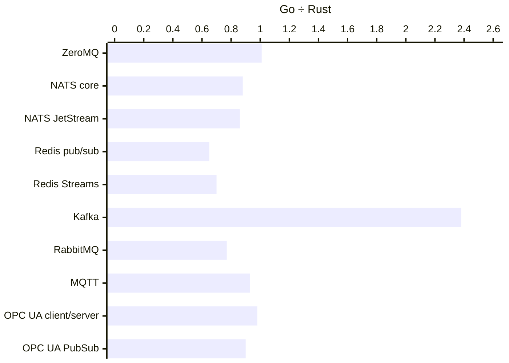

### Go ÷ Rust, unpaced batch, plaintext

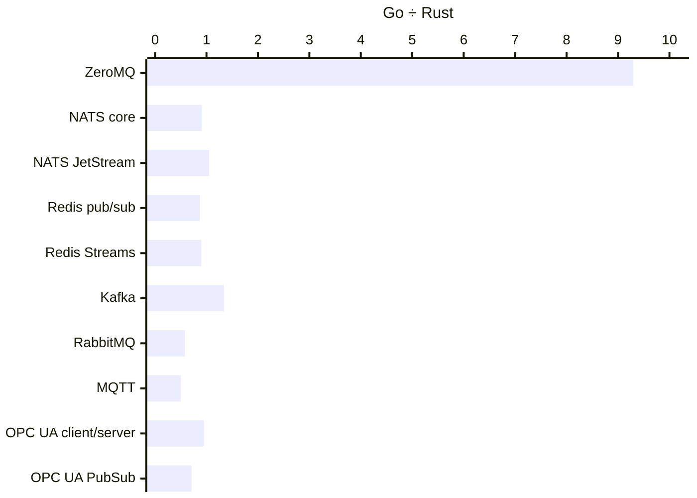

### Go ÷ Rust, unpaced fanout, tls, production durability

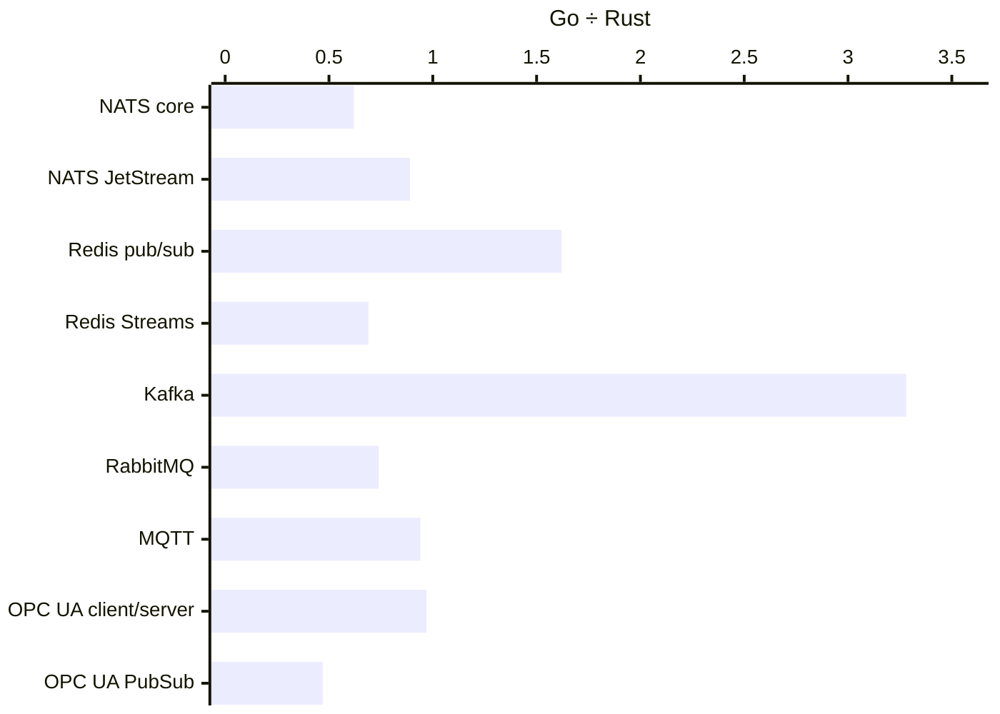

### Go ÷ Rust, unpaced batch, tls, production durability

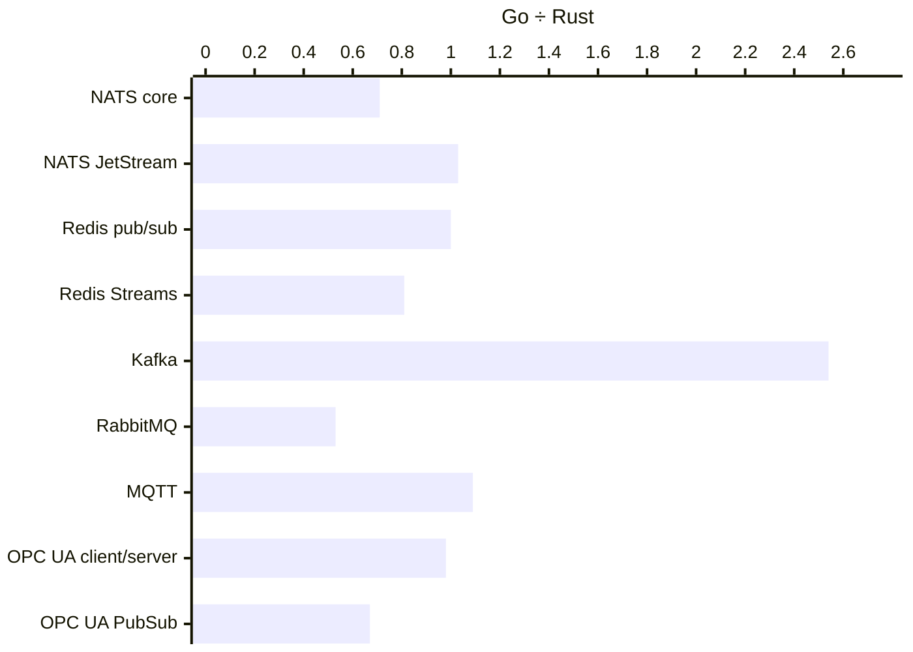

### Where the Go driver differs by design

| Backend | Go | Rust |
| --- | --- | --- |
| OPC UA PubSub | a batch's network messages sent one at a time | a batch's network messages sent together (`send_all`) |
| OPC UA client/server | latency from the source timestamp the server gives the written value | latency from the send time the client writes as the value's source timestamp |
| Kafka | producer batch bounded by bytes, not message count | librdkafka batch bounded at 10,000 messages (`batch.num.messages`) |
| Redis Streams | ack does not wait for XACK (`REDIS_CONFIRM_ACKS=0`) | ack does not wait for XACK |

## Against each broker's own tool

Same machine, same broker, both through Docker Desktop's port forward. Tool figures from the runtime-rs baseline run (`native-baseline.sh`, shared by both runtimes).

| Broker | Official tool | Tool msg/s | Scenario | Go msg/s | Go ÷ tool | Rust msg/s | Rust ÷ tool |
| --- | --- | ---: | --- | ---: | ---: | ---: | ---: |
| NATS core | `nats bench` pub + sub, 1 client each | 509,981 | fanout, unpaced | 395,264 | 78% | 450,360 | 88% |
| NATS JetStream | `nats bench js pub async`, message ids | 195,332 | batch, unpaced | 130,255 | 67% | 124,506 | 64% |
| Kafka | `kafka-producer-perf-test`, acks=all, idempotent | 601,685 | batch, unpaced | 1,497,463 | 249% | 1,118,949 | 186% |
| Kafka | `kafka-consumer-perf-test` | 428,266 | durable, unpaced | 141,059 | 33% | 47,321 | 11% |
| RabbitMQ | `perf-test`, persistent, confirm 500, transient queue | 78,394 | batch, unpaced | 99,038 | 126% | 171,349 | 219% |
| RabbitMQ | `perf-test`, persistent, confirm 500, durable queue, acks | 48,851 | durable, unpaced | 54,130 | 111% | 52,899 | 108% |
| MQTT | `emqtt-bench`, QoS 1, publishers over 10 topics | 33,649 | fanout, unpaced | 89,586 | 266% | 96,232 | 286% |
